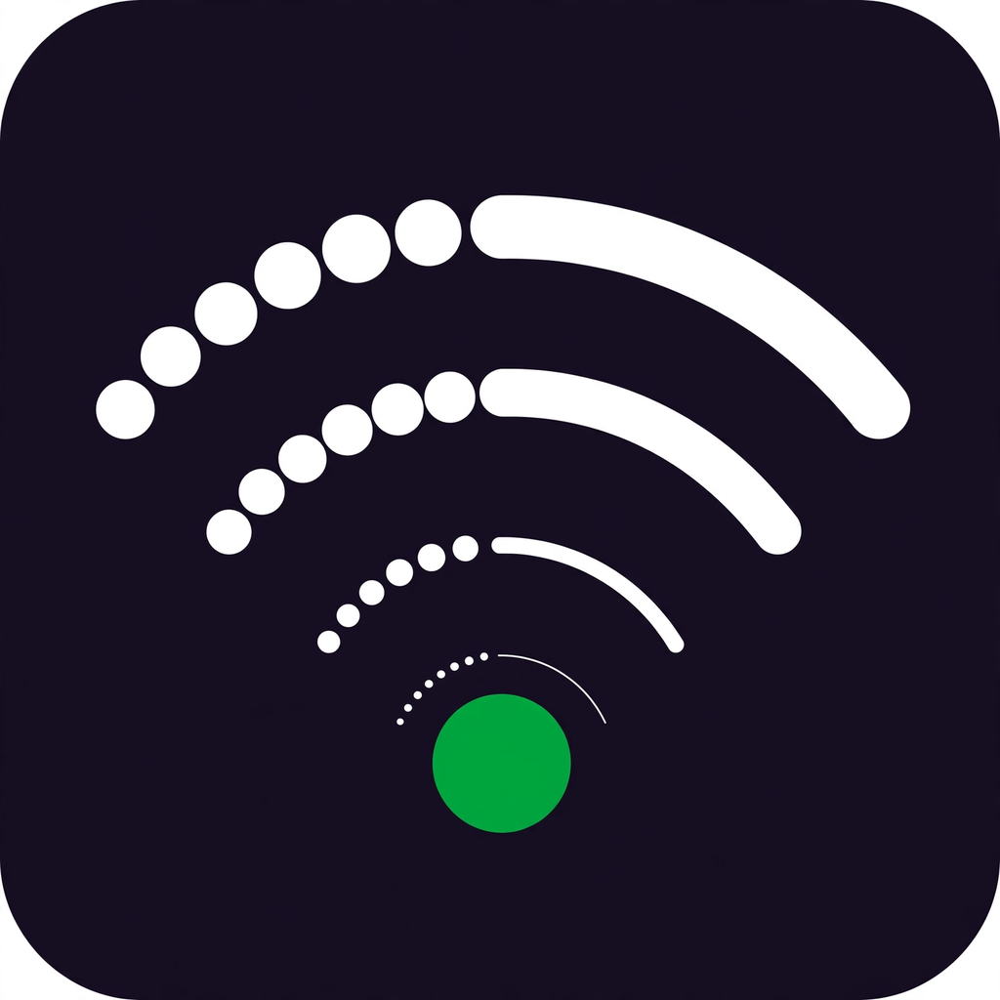

<p align="center">
  
</p>

# Airplane

*the feed that works in airplane mode.*

[](https://github.com/bunnysayzz/airplane/actions/workflows/ci.yml)
[](https://github.com/bunnysayzz/airplane/actions/workflows/codeql.yml)
[](LICENSE)
[](https://github.com/bunnysayzz/airplane/releases)

**Airplane** is an open source Android app: an anonymous, location based
public feed that works over a phone to phone Bluetooth mesh and, when the
internet is available, public Nostr relays. No accounts, no phone numbers,
no servers, no Google services. Built for protests, concerts, and anywhere
the network is gone.

Posts are ranked by **views, not likes**: what people actually see rises,
what nobody sees dies out.

This README describes the merged tree on main: the six track batch of
November 2026 (DM transport parity, feed new posts at top, private
Saved messages, DM and feed polish, identity and display names, and
the persistent feed cache) plus the transport batch that followed it
(BLE flood forwarding for posts, the durable post outbox, relay-first
fanout with World confirmed on query hit only, DM service start at
launch, DM Relayed re-publish, DM silence and head-of-line fixes,
unread counts, and the last-known location fallback). No release has
been cut from this merged tree yet, so no release APK contains this
batch yet, and no version number is quoted for it here. Device proof
for this batch is still pending: the two-phone checks below are the
gate, and nothing in this README counts as proven until those checks
pass on real phones.

## One feed, hybrid transport

There is **one feed**. No tabs, no separate destinations.

"World" is not a place you post to. It is a *status* a post earns when a
copy of it reaches the relay network:

- **Mesh-only** posts show no icon. This is the default, and it is clean
  on purpose.
- **World-confirmed** posts show a tiny 🌐. The icon means something
  because it is rare.

The globe appears on a query hit only, never instantly on a relay OK.
A relay OK means the relay accepted the envelope; it does not prove
the relay still holds it. After a relay win, the app runs a WorldSync
pass at once (instead of waiting up to 60 seconds for the next timer
tick): the pass re-pushes the still-unconfirmed post and queries
relays for it, and only a query hit confirms it. A relay that OKs
then drops the event leaves no globe, and the post stays unconfirmed
for later passes to re-push. The same rule covers direct wins: the
globe arrives one query round trip later, by design. A relay OK is
acceptance, not delivery, and never by itself a globe.

Every post is signed on device with your Ed25519 key and sent through
the ordered router, relay first, not over every transport at once:

- **Nostr relays first**: when the phone is online (tracked with
  NetInfo, no Google Play Services), the router tries relays first
  with a 5 second first-OK deadline (1500 ms while the network state
  is still unknown, so a dead hotspot cannot burn the full deadline
  before mesh fallback). A relay win also hands the post to
  connected Bluetooth peers, best effort, so a nearby offline peer
  receives it at publish time; the relay result is unchanged by
  that leg. The app pushes
  unsynced posts, pulls new events, and checks relays for its
  unconfirmed event IDs.
- **BLE mesh fallback**: when relays do not win, the post goes over
  BLE to connected peers. BLE runs whenever the radio is up,
  independent of the internet. Phones forward posts hop by hop
  (controlled flood, TTL 7, see below), whether or not the internet
  exists.
- **Queued when neither can send**: a post that reaches no transport
  is not lost. It is saved locally and queued in the durable post
  outbox (see Features), and it drains later over BLE or relay.

A hotspot is not a separate transport. A phone sharing its connection
is just internet reachability (NetInfo) plus BLE: if the hotspot has
upstream data, the relay leg runs; if it has none, reachability
reports offline and the relay leg is skipped, exactly as on a dead
Wi-Fi network.

Dedup is by event ID (SHA-256 of the signed bytes), identical across BLE
and Nostr, so a post arriving twice is one post.

**Silent background uplink.** When your phone is online and receives a
post that is not yet World-confirmed, it uploads the exact signed bytes
to relays: silently, in the background, with no approval and no prompts.
Relays cannot modify a post (the signature covers the full payload); they
can only copy it. Onboarding says this once, then never again:

> "Posts you send may reach the wider network through other phones."

There is no local-only post. If you post, assume it can reach the world.
The old opt-in World gate was a false promise (mesh is already
broadcast), so it was removed.

## Features

### Feed

- **Text posts**: 280 Unicode chars (NFC-normalized), append-only, no
  edits.
- **Anonymous by design**: no accounts, no phone numbers. Posts are
  signed with a locally generated Ed25519 key that never leaves your
  device.
- **Location-scoped feed**: posts from your geohash-5 cell (about
  4.9 km by 4.9 km) plus its 8 neighbours. Raw coordinates are never
  stored.
- **Ranked by views, not likes**: `score = log10(1+views) /
  (ageHours+2)^1.5`. Log scaling dampens Sybil gaming; one countable
  view per (device, post, UTC day).
- **Offline mesh relay**: BLE GATT controlled flood (TTL 7 hops, 50 to
  500 ms sampled relay jitter, 10k-entry seen-cache dedup), fragmented into
  frames of at most 469 bytes. Flood forwarding is real: a bridge phone
  that receives a post over BLE re-broadcasts it after one sampled
  jitter to all connected peers except the peer it came from, with the
  TTL decremented first and the forward dropped when the decremented
  TTL reaches 0. The seen set is checked before forwarding, so a
  duplicate overheard before the jitter fires cancels the scheduled
  forward. Only kinds 1, 2, and 3 flood (posts, view receipts,
  tombstones); stars and reshares are origin broadcast only and are
  never re-flooded by a bridge. DM frames never forward: the feed
  reassembler accepts only feed-channel frames, so a DM frame is
  ignored before buffering and can never be flooded onward. The frame
  format is unchanged, so older installs receive a forwarded post
  exactly like an origin post but do not forward it onward; a mixed
  network degrades gracefully instead of looping. See
  [docs/spec/flood.md](docs/spec/flood.md).
- **Store-and-forward, with a durable outbox**: posts live on device
  in SQLite; your post propagates when peers show up. Being alone is
  the normal case, not an error. Own posts are also queued in the
  `post_outbox` table at save time, before fanout runs, so a kill
  during fanout still leaves a retryable row. The outbox holds
  delivery state only, never unsaved text. It drains over BLE on peer
  arrival, at transport start, and on foreground radio re-validation,
  oldest first; relay retry stays with WorldSync, which runs on a
  fixed 60 second tick plus connectivity return, foreground return,
  and immediately after a relay win, and drains unconfirmed posts
  oldest first (at most 50 per pass). The drain never sends over BLE
  first while online, because that would break relay-first order;
  World confirmation deletes the outbox row.
- **Honest card states, and a saved toast**: after publish, the toast
  says "Post saved". That confirms the local save only, not delivery.
  Delivery lives on the feed card: the globe when a relay query hit
  confirms World (see above), "Unsent" on your own post while its
  outbox row reached no transport, and neither mark while the row is
  still fresh (a pending row counts as Unsent only after 10 seconds,
  so a fanout still in flight does not flash Unsent) or while it was
  handed to the radio over BLE and still awaits World. A card handed
  to the radio is never called delivered: a GATT notify can resolve
  even with no peer app subscribed, and there is no BLE ack frame for
  posts in this batch, so "handed to radio" is the strongest honest
  wording. The post BLE ack frame is a follow-up, not shipped work.
- **Last-known location fallback**: when the fresh fix fails with a
  timeout or an unavailable provider, and only then, the post falls
  back to a real previously seen area: the OS last-known position at
  any age, else the app's own expired cache cell. The fallback cell
  is never written back into the fresh cache, never invented, and
  permission or services failures never reach it (those still fail
  the post). A fallback post carries the signed
  `["location_source", "last-known"]` tag, and its feed card shows
  "Last known area", so readers can tell the cell may be stale.
  Older installs ignore the tag and show no marker.
- **Cell scoping is display scoping, not delivery scoping**: the feed
  list shows your geohash-5 cell plus its 8 neighbours. A far post
  can still be relay-delivered and stored (a bridge forwards
  regardless of cell, and relays do not know your feed scope), but
  it stays invisible in the feed list by design. That is not a lost
  post; it is a post outside the area you asked to see.
- **Connectivity-aware transport**: NetInfo wiring starts Nostr and
  WorldSync when online and stops them when offline; BLE keeps running
  either way. A hotspot with no upstream data reports reachability
  false, so the relay leg is skipped and the app behaves as offline,
  with BLE only.
- **New posts at top**: while you are scrolled down, new arrivals pile up
  behind an "N new posts" pill instead of yanking the list. Tapping the
  pill snapshots the on-screen post IDs, refreshes, pages ranked pages
  without touching the pagination cursor until a fresh card is found,
  then prepends the fresh cards newest first and scrolls to the top.
  Fresh posts used to score zero (zero views) and sort below every viewed
  post, past page 1. That cause is fixed. The pill count itself is still
  notification based, not post based, so counts can be noisy. See
  [docs/feed.md](docs/feed.md).
- **Persistent feed cache**: previously loaded posts stay visible
  offline with zero nearby peers. A live refresh merges fresh cards at
  the top, deduped by event ID. Retention is 100 posts per geohash-5
  cell, 500 total, 512 KiB serialized, trimmed from the end of the
  display list, with no time expiry: a card stays until it is pushed out
  by count or size, even past the store 24 hour window. The UI stays
  honest about the source: "Showing saved posts." for cached cards,
  "Nothing here yet - be the first to post." when genuinely empty,
  "No posts in this area yet." for a new cell with no posts, and
  "No posts in this area yet. Showing saved posts from other areas."
  when the saved cards belong to other cells. See
  [docs/feed.md](docs/feed.md).
- **Star**: public endorsement (signed reference events); counts are
  partial lower bounds, never fed into ranking.
- **Reshare**: collapsed cluster on the original card, never duplicate
  cards; reshare-of-reshare flattens to the original.
- **Delete your own posts**: deletions are tombstone events the network
  honors.
- **No backend**: no server to deploy, rate-limit, subpoena, or take
  down.
- **Anonymous, not encrypted**: post *contents* are public by design
  (anyone in radio range can read them, like shouting in a square).
  What is protected is your *identity*. The app never promises
  encryption of post contents.

### Direct messages: relay and BLE, with honest states

DMs move over **both** transports now: Nostr relays and BLE to directly
connected peers. There is no multi-hop DM in v1. See
[docs/dm-transport.md](docs/dm-transport.md) for the full contract.

Outgoing messages show exactly one of these states. No state claims more
than it proves:

| State | Label in the thread | What it means |
|---|---|---|
| Sending | Sending | An attempt is in flight. Never a final state. |
| Queued | Queued, waiting for a transport | No transport exists right now. Retried, never Failed while no transport exists. |
| Relayed | Sent to relay, not delivered yet | A relay accepted the envelope. The relay holds it; no peer has confirmed it yet. Re-published with the identical envelope (same event ID) only after a 24 hour ack window with no ack, at most 3 re-publishes. A re-publish that finds no relay reachable does not burn the cap; the row stays Relayed and retries soon. A re-publish that a relay accepts or rejects burns one attempt and starts a fresh 24 hour window. A Relayed row past its cap with no ack still stays Relayed: it has no Failed state by time alone. The label stays Relayed while the window runs. |
| MeshSent | Sent over BLE, not delivered yet | A BLE notify went out to a connected peer, but no peer app has acked yet. Re-attempted when due (30 seconds) or on force flush; a relay success upgrades it to Relayed; 5 mesh sends without an ack end in Failed. |
| Delivered | Delivered | Only on a verified peer ack. See below. |
| Failed | Failed, tap to retry | Hard failures exhausted. Tap to retry re-queues the message. |

Sending is optimistic: the row is stored and the send returns at once,
and a background flush does the work. A flush is forced when the app
returns to the foreground, when connectivity returns, and when the BLE
peer count changes from 0 to N or back.

The DM service starts at app launch, not only when Messages opens.
Launch cost is one subscribe plus one forced flush, plus the capped
pending-ack resend below. This is not a background service: no new
timer, no background task, and no periodic work is added. The outbox
timer still arms only when a row is due.

Half-open sockets are now detected, not waited out. A 90 second
silence timer runs per relay on both the post and DM relay paths: any
inbound frame resets it, and a silent socket is force-closed and
reconnected, which re-sends the subscription with backfill. React
Native WebSocket exposes no ping, so there is no ping grace on the DM
path: the timer closes the socket instead of delaying recovery. A
relay CLOSED for the live subscription triggers an immediate
resubscribe on the same sockets, also with backfill, and the app
foreground refresh remains as a backstop.

Head-of-line is fixed per conversation: a row that turns terminally
Failed inside a flush does not block later rows to the same peer; the
flush continues past it. A transient failure (Queued, or a MeshSent
retry still due) still stops that conversation's queue, so order is
kept while a transport is merely slow. Other conversations flush
concurrently and keep doing so.

Lost-ack resend: when a message is stored, the recipient sends its ack
and records whether the ack left on at least one channel (relay OK or
a BLE peer count above zero). There is no ack of an ack, so that marker
means the ack was sent, not that the sender processed it. On service
start, the recipient re-sends acks for stored inbound messages whose
ack never left, newest first, capped at 100 per start, skipping
blocked conversations and rows without a delivery ID. A re-sent ack
upgrades the sender on a late ack, including from Failed, with no wire
change, and never touches unread counts.

Unread counts: each DM row shows its own unread pill, and the Messages
tab badge shows the numeric total for inbox conversations only, with
muted conversations excluded and requests excluded (requests carry
their own row pills). Opening a thread marks that conversation read,
and messages arriving while the thread is open are read on sight, so
they do not stay counted after you leave the thread. Counts are
persisted with dedup by delivery ID (persisted seen set, surviving
restart), so a re-publish or a relay replay renders once and counts
once, never inflating the count. Own messages and Saved notes never
count.

**Delivered means acked, not read.** A peer app sends an ack when it
stores the message, not when the user opens the thread. Each send carries
a per-send 32-hex delivery ID in the envelope, and the ack carries an
HMAC-SHA256 proof keyed by the conversation key, which the sender checks
against the proof it stored at send time. Acks are Airplane-private kind
1060 events; message envelopes stay kind 1059. Acks are not read
receipts, and no read receipts exist.

DMs are sealed so only the recipient decrypts, with the MAC checked.
Incoming rows are stored sealed only; outgoing rows keep the sender's
own plaintext so the sender thread still renders after a restart.
Conversations keep the newest 1000 messages each. Deleting a
conversation deletes its rows locally but keeps the seen set, so a relay
replay cannot resurrect it.

Interop with old installs is honest, not silent breakage. Old installs
drop BLE DM frames at parse (flags 1 rejected) and never see acks (they
subscribe to kind 1059 only), so new to old stays Relayed. Envelopes
from old senders carry no delivery ID and cannot be acked.

DM threads show "No messages yet." when empty. Unknown senders land in
Requests, never straight in the inbox. Block and mute are local.

### Saved messages: a private conversation with yourself

The Messages tab has a pinned **Saved** row above the Inbox: count only,
no snippet, labelled "This device only. Never sent to anyone." Tapping
it opens a thread at `/dm/self` that reuses the DM layout with a Save
button and no Sending, Sent, or Failed labels, because there is no send.

Saved notes live in app private key-value storage under key
`self-messages-v1`, capped at 4096 UTF-8 bytes per note and 1000 notes
(oldest dropped first). Notes survive restart **and** identity burn or
rotate, because they are device bound, not identity bound. Notes are
plaintext in app private storage: the OS sandbox is the only protection,
there is no encryption at rest, and notes never enter any publish or
send path. See [docs/self-messages.md](docs/self-messages.md).

### Identity: display names, memorable names, generated avatars

You can set a display name in Settings, Identity: 1 to 32 characters.
It travels as a signed claim: posts carry a `["display_name", name]` tag
covered by the author's Ed25519 signature, so a relay or a peer cannot
rewrite your name on your post without breaking the signature. Older
installs ignore the tag safely. Clearing your name does not retract
claims peers already recorded from your earlier posts.

When no display name is set, the feed falls back to the memorable name:
an adjective plus a noun derived deterministically from the pubkey
(the wordlists are unchanged). Feed cards, DM rows, and thread headers
show the clean name with **no hex suffix**; the suffix appears only when
two known peers share the same base name, and avatar colors differ
regardless, so same-name peers still look different. The full key and
the full label stay visible on the Identity screen and behind a Details
toggle in a DM thread. A display name survives a key burn, because it is
kept in device storage.

**Message by username.** The Messages input searches known peers only:
inbox, requests, blocked, and authors of posts this device has seen,
ranked exact, then prefix, then substring. Paste a 64-hex pubkey as the
fallback. The hard limit is real: a never-seen peer cannot resolve by
name. There is no central directory and no relay lookup.

**Generated avatars.** Every peer gets initials plus a deterministic
two-stop gradient derived from their pubkey bytes (expo-linear-gradient,
already a dependency). The avatar is stable across devices and distinct
per peer, and it is used everywhere avatars appear. See
[docs/identity.md](docs/identity.md).

## Install

Sideload-first. The threat model includes store takedowns, so stores are
not the primary channel.

**Android:** install the APK from
[GitHub Releases](https://github.com/bunnysayzz/airplane/releases).
Verify the download against the published `SHA256SUMS.txt` before
installing. The batch described above has no release yet: it lands in
a release only after this docs branch merges and a new release is cut,
so check the release notes for the batch before testing it from a
release APK. Until then, the release APK does not contain this batch.

Android will warn about unknown sources. That is expected for a sideloaded
app. Import the releases page in
[Obtainium](https://obtainium.imranr.dev/) for updates. Install only
from the official releases page, never from forwarded files or mirrors
you cannot verify.

**iOS:** no public build yet. CI produces an unsigned IPA artifact for
AltStore testing (free Apple ID, 7-day expiry, your own iPhone only).
Signed builds need Apple Developer enrollment, which is pending. Note
also that iOS background BLE is OS-crippled (Apple throttles background
advertising and scanning hard), so iOS participates opportunistically;
Android is the relay backbone.

## Test with two phones

This is the gate for the batch. Lab devices racked apart and emulators
with no radio cannot prove BLE discovery, so these checks need two
physical phones in range, plus a third phone as a bridge for check 10.
Run them on the merged tree, in this order:

1. **Peers connected on both phones.** Both phones show the other as a
   connected BLE peer.
2. **Posts both directions, offline.** With the internet off on both
   phones, a post from each phone appears on the other.
3. **DM both directions, offline, ending Delivered.** With the internet
   off, send a DM each way between connected peers and confirm each
   thread reaches Delivered, which requires the verified peer ack, not
   just a BLE notify.
4. **New posts at top on pill tap.** Scroll down, let new posts arrive,
   tap the "N new posts" pill, and confirm the fresh cards prepend
   newest first at the top and the list scrolls to the top.
5. **Cached feed survives kill plus relaunch, offline.** Load the feed,
   kill the app, relaunch with no peers and no internet, and confirm the
   previously loaded posts are still visible with the "Showing saved
   posts." banner.
6. **Saved notes survive restart and are never sent.** Save a note,
   restart, confirm it is still there, and confirm no relay publish or
   BLE send carries it (the store has no publish or send path at all).
7. **Display name visible on the other phone.** Set a display name on
   phone A, post, and confirm phone B shows the clean name on the card
   with no hex suffix (unless a collision forces one).
8. **Username DM start.** On phone B, type the phone A author's name in
   the Messages input and start a DM from the match, without pasting a
   key. Confirm a never-seen name does not resolve.
9. **Outbox drain and Unsent.** With no peers and no internet, post on
   phone A and confirm the card shows Unsent and the toast said only
   "Post saved". Kill and relaunch, then bring phone B into range
   (still offline) and confirm the post drains over BLE and the
   Unsent mark clears.
10. **Bridge flood, offline.** With three phones in a line (A sees B,
    B sees C, A does not see C) and the internet off everywhere, post
    on A and confirm the post reaches C through B, and a post from C
    reaches A the same way. Confirm a DM sent on the same setup does
    not hop: DMs stay direct-peer only.
11. **Globe on query hit only.** Online, post on phone A and confirm
    the globe does not appear instantly on the relay OK; it appears
    after the follow-up WorldSync query round trip. Then, if a relay
    can be made to drop the event before the query, confirm no globe
    appears for it.
12. **Relay win plus Bluetooth.** Online on phone A with phone B
    connected over Bluetooth but offline, post on phone A and
    confirm B receives the post over Bluetooth while staying
    offline, and the Diagnostics record shows the relay stage
    winning plus a Bluetooth handoff leg for that post.
13. **Unread pills, badge, read on sight.** Send a DM to phone B while
    B is not in the thread and confirm B's row pill and the Messages
    tab badge both count it. Open the thread on B and confirm both
    counts clear, and a message arriving while the thread is open does
    not stay counted after leaving it. Restart B and confirm a relay
    replay of the same message does not inflate the count.
14. **Last-known marker.** With a fresh fix unavailable (provider
    timeout or unavailable, not a permission denial), post and confirm
    the card shows "Last known area". Confirm a permission denial
    still fails the post instead of falling back.
15. **Far post stored but feed-invisible.** Relay a post from a cell
    far outside phone B's 9-cell scope and confirm it does not appear
    in B's feed list, by design, even though it was relay-delivered.

Two timed behaviours are not practical one-session phone checks and
are gated on code plus timed observation instead: the 24 hour DM
Relayed re-publish window with its 3-attempt cap (unreachable relays
must not burn the cap), and the 90 second relay silence timer with
CLOSED resubscribe. Do not claim either as phone-proven from a short
session.

## Build from source

Prerequisites: **Node 24** (pinned via `.nvmrc`), npm. These commands
are taken from the repo root `package.json` scripts and the app
`package.json`, not invented here:

```bash
git clone https://github.com/bunnysayzz/airplane.git
cd airplane
npm install
npm test            # full Jest suite
npm run typecheck   # strict tsc --noEmit across all 6 projects
npm run lint        # eslint, zero warnings allowed
```

Run the app:

```bash
cd apps/mobile
npx expo start      # scan the QR code with Expo Go, or press `a` / `i` for an emulator
```

Android release APK (the route release builds actually use; EAS is not
used):

```bash
cd apps/mobile/android
./gradlew assembleRelease -PreactNativeArchitectures=arm64-v8a --no-daemon
```

The `android/` directory is committed; no Expo prebuild runs in CI.
Release APKs are attached to GitHub Releases by
[`.github/workflows/publish-test-apk.yml`](.github/workflows/publish-test-apk.yml).
Release builds are debug-signed today; a production keystore is pending
(T12). See [`docs/release-runbook.md`](docs/release-runbook.md) for the
release pipeline.

## Architecture

Strict layering, one-way dependencies:

```
apps/mobile (React Native + Expo)
  → packages/transport (BLE + Nostr hybrid, WorldSync)
  → packages/protocol (signed CBOR events, flood engine, ranking, geohash)
  → packages/storage (StorePort / KvPort / DatabasePort)
  → packages/crypto (Ed25519)
  → packages/mesh-sim (in-memory radio for tests + dev)
```

Data flow for one post: compose, create, sign (Ed25519), fragment (frames
of at most 469 bytes), flood (TTL 7, jitter 50 to 500 ms, seen-cache LRU
10k), verify, save, receipts, rank, list, render.

### Transport

Posts and DMs share the BLE fragment layer but not the channel. Fragment
headers carry a channel flag: 0 is feed, 1 is DM. Each reassembler
accepts only its own channel, so DM frames never reach the feed path.
Posts flood hop by hop (kinds 1, 2, and 3 only, TTL decremented before
forwarding, seen-set dedup, sampled jitter, ingress peer excluded);
DMs go only to directly connected peers in v1, with no multi-hop.

The post router is ordered, relay first. A relay win ends the router
decision, and the post is also handed to connected Bluetooth peers,
best effort, so a nearby offline peer receives it at publish time;
a Bluetooth failure never changes the relay result. Only a relay
loss, rejection, or timeout falls through to BLE alone, and only no
transport at all reports queued. The queued report
is not storage: the durable post outbox owns persistence and drain
(see Features). A hotspot is not a transport stage in this router;
it is NetInfo reachability plus BLE.

Relays use pooled sockets with parallel publish and a 5 second first-OK
deadline: the first relay OK settles the publish, and an explicit relay
rejection settles it at once instead of waiting out the deadline.
WorldSync runs on a fixed 60 second tick plus connectivity return,
foreground return, and immediately after a relay win; each pass pushes
unconfirmed posts oldest first (at most 50 per pass) and queries relays
for them, and only a query hit confirms World. DM subscriptions
resubscribe live with backfill from the last envelope or ack seen,
minus a 300 second overlap; the first subscribe replays at most the
last 24 hours. Both relay paths run a 90 second silence timer with
force-close and reconnect, and immediate resubscribe on CLOSED. The
DM service starts at app launch (one subscribe plus one forced flush,
plus capped pending-ack resend), not only when Messages opens; that
is not a background service.

### Identity

Ed25519 device keys, generated on first launch, never leave the device.
The memorable name is derived deterministically from the pubkey. A
user-chosen display name is a signed post tag, recorded by peers in a
local peer registry when they see a post carrying it. DM payloads carry
no display name yet, so a DM-only peer shows their memorable name until
they post. See [docs/identity.md](docs/identity.md).

### Storage

- **SQLite posts store** (`airplane.db` feed tables): signed posts,
  stars, reshares, receipts. The 24 hour store window still applies to
  store rows; the feed cache is a separate display layer with no time
  expiry, so a cached card can outlive its store row.
- **SQLite DM store** (`airplane.db` tables `dm_conversations`,
  `dm_messages`, `dm_seen`): sealed DM rows, conversation state, and the
  seen delivery IDs that stop relay replay from resurrecting a deleted
  conversation.
- **Key-value store** (MMKV on device): Saved notes
  (`self-messages-v1`), the own display name, and the feed cache
  (`feedCache.v1`). KV is device storage, not identity storage, which is
  why Saved notes and the display name survive a key burn.

Wire truth lives in [`docs/spec/`](docs/spec/): wire format, flood
rules, BLE GATT details. Protocol constants (TTL, frame budget, ranking
exponent, cell precision) are defined in
[`packages/protocol/src/events/types.ts`](packages/protocol/src/events/types.ts)
and documented in the spec, not duplicated here.

## Privacy model

Full policy: [PRIVACY.md](PRIVACY.md). Short version:

**What never leaves the phone.** Saved notes: they have no publish or
send path at all. DM plaintext for incoming messages: incoming rows are
stored sealed only and decrypted on read; the sealed payload is what
relays and BLE peers carry. Diagnostics never contain post or message
content, keys, coordinates, or cell IDs. Raw coordinates are never
stored; only the geohash-5 cell is attached to posts.

**What relays see.** Signed public posts, including any display name
tag the author chose. Sealed DM envelopes (kind 1059) that only the
recipient can decrypt, with the MAC checked. Ack events (kind 1060)
carrying a delivery ID and an HMAC proof, not message text. Relay
operators can also see the uploader's IP address while uploading, just
like any website visit.

**What BLE peers see.** Advertised tags and post fragments in radio
range, and sealed DM frames addressed to directly connected peers only.
A mesh bystander that overhears a delivery ID cannot forge an ack proof,
because the proof needs the sender ephemeral secret or the recipient
secret, neither of which the bystander holds.

**What is deliberately kept on disk.** Outgoing DM plaintext persists
in the SQLite DM store by design, so the sender thread renders after a
restart. That is the sender's own words, in the same database file that
already holds feed posts in plaintext. It is not a leak to a peer or a
relay; it is a local storage choice, and it is stated here so it is not
discovered by surprise.

**What this app does not promise.** Encryption of post contents. Metadata
protection against a local radio observer. Protection from a relay
knowing your IP. Takedown power over copies other phones or relays made.
Sender authentication for DMs: see Limitations. A display name is a
signed claim from a key, not proof of who someone is offline, and a
relay OK or a globe is acceptance or a query hit, not delivery proof
and not identity proof: do not treat either as authenticated identity
or as proof a peer received anything.

## Status and limitations

Stated plainly, not hidden. The six tracks plus the transport batch
are merged on main; device proof on the merged tree is pending, and
the two-phone checks above are the gate. Nothing in this section is a
roadmap promise with a date.

- **DM sender authentication still open (P0-3, separate decision).**
  The rumor sender pubkey is an unsigned claim: anyone can seal a
  rumor to a recipient, the same property as NIP-17. Abuse is handled
  by the Requests folder and block, not by authentication. A signed-DM
  fix would break interop with existing installs and needs a user
  decision. Display names and relay acceptance are not a substitute:
  see Privacy model.
- **Multi-hop DM absent.** DMs reach directly connected peers only in
  v1. A peer two hops away is reachable by relay, not by BLE.
- **NIP-42 AUTH unanswered (separate decision).** A relay that
  challenges with AUTH gets no answer; AUTH is never allowed to gate
  delivery or crash the app.
- **Half-open sockets: silence timer, no ping.** A 90 second silence
  timer force-closes and reconnects a silent relay socket on both the
  post and DM paths, and CLOSED triggers immediate resubscribe. React
  Native WebSocket exposes no ping, so no ping is sent on the DM path.
- **Relayed re-publish is capped, not endless.** A Relayed row
  re-publishes only after a 24 hour ack window, at most 3 times, with
  the identical envelope; unreachable relays do not burn the cap. A
  capped Relayed row with no ack stays Relayed, with no Failed state
  by time alone.
- **Post BLE ack frame absent (follow-up).** There is no BLE ack for
  posts, so BLE post delivery is reported only as handed to radio,
  never as delivered. A post BLE ack frame is follow-up work, not
  shipped in this batch.
- **Replay pagination and per-peer watermarks absent (follow-up).**
  Replay past 500 and per-peer watermarks are not in this batch; the
  current bounds are the 24 hour first-subscribe window and the
  300 second resubscribe overlap below.
- **Foreground service absent (T4, separate decision).** There is no
  Android foreground service for background relay in this batch; the
  DM service starting at launch is app-launch wiring, not a
  background service.
- **Backfill window limits.** First subscribe replays at most the last
  24 hours; resubscribe backfills from the last envelope or ack minus
  300 seconds. Anything older than relay retention is still missed.
- **Old-sender envelopes cannot be acked.** Envelopes without a
  delivery ID have nothing to ack against, so they stay at whatever
  handoff state they reached.
- **Outgoing DM plaintext persists on disk by design.** See Privacy
  model above.
- **Feed pill count is notification based, not post based.** Counts can
  be noisy even though the prepend itself is now correct.
- **DM display name gap for DM-only peers.** DM payloads carry no
  display name yet, so a peer you have only messaged shows their
  memorable name until they post.
- **Cached card detail expiry gap.** A cached card whose store row
  passed the 24 hour expiry may show "post could not be found" on the
  detail route, which reads the store directly, even though the card
  still shows in the feed list.
- **Key rotation device check pending.** The Identity page offers burn
  and rotation; the real-device rotation check is still open work.
- **iOS limits.** Background BLE is OS-throttled; iOS participates
  opportunistically and Android is the relay backbone.

## Merged tree

The six feature branches and the transport batch (publish fix, DM
unread counts, DM transport, post transport, router, and draft
persistence) are merged on main, and this docs branch describes that
merged tree. The old "Sent to relay" wording is subsumed by the DM
states table above and is not a state. This docs branch merges after
the code branches; it changes docs only, no code, no version, no
release.

## Documentation

- [`docs/dm-transport.md`](docs/dm-transport.md): DM relay plus BLE
  transport, delivery states, Relayed re-publish, acks, unread counts,
  SQLite DM store, interop
- [`docs/identity.md`](docs/identity.md): Ed25519 keys, memorable names,
  signed display names, username messaging, generated avatars
- [`docs/self-messages.md`](docs/self-messages.md): Saved notes store,
  limits, durability, privacy at rest
- [`docs/feed.md`](docs/feed.md): new posts at top, persistent feed
  cache, durable post outbox and Unsent, World on query hit only,
  last-known marker, honest UI states, retention caps
- [`docs/blueprint/hybrid-single-feed-plan.md`](docs/blueprint/hybrid-single-feed-plan.md):
  the single-feed hybrid design (current)
- [`docs/blueprint/ARCHITECTURE.md`](docs/blueprint/ARCHITECTURE.md):
  headline decisions, scope, requirements
- [`docs/blueprint/SYSTEM_DESIGN.md`](docs/blueprint/SYSTEM_DESIGN.md):
  layers, node inventory, data model, contracts
- [`docs/blueprint/DIAGRAMS.md`](docs/blueprint/DIAGRAMS.md): diagram set,
  sequence flows
- [`docs/blueprint/ROADMAP.md`](docs/blueprint/ROADMAP.md): phased plan
  with acceptance criteria
- [`docs/blueprint/OPERATIONS.md`](docs/blueprint/OPERATIONS.md):
  operations notes
- [`docs/spec/`](docs/spec/): wire format, flood, BLE GATT (source of
  truth for `packages/protocol`)
- [`docs/threat-model.md`](docs/threat-model.md): security posture
  (draft)
- [`docs/release-runbook.md`](docs/release-runbook.md): how releases get
  cut and published
- [`docs/assumption-register.md`](docs/assumption-register.md): open
  assumptions and their owners
- [`docs/adr/`](docs/adr/): architecture decision records (template in
  place; records to be added as protocol decisions land)

## Repository structure

```
airplane/
├── apps/
│   └── mobile/            # Expo app: feed, composer, settings, onboarding, services
│       ├── app/           # expo-router: (tabs)/feed, (tabs)/messages, (tabs)/settings, post/[id]
│       ├── services/      # airplane services: feed, composer, transport, storage adapters
│       └── android/       # committed Android project (no prebuild in CI)
├── packages/
│   ├── protocol/          # @airplane/protocol: events, CBOR codec, flood, ranking, geohash
│   ├── storage/           # @airplane/storage: ports, schema, op-sqlite/MMKV drivers
│   ├── crypto/            # @airplane/crypto: Ed25519
│   ├── transport/         # @airplane/transport: BLE + Nostr hybrid, WorldSync
│   └── mesh-sim/          # @airplane/mesh-sim: in-memory radio for tests + dev
├── docs/                  # blueprint, spec, adr, threat-model, release-runbook, plus dm-transport, identity, self-messages, feed
├── scripts/               # repo tooling (incl. native-module payload gate)
├── .github/workflows/     # ci.yml, build-apk-no-eas.yml, publish-test-apk.yml, ...
├── .nvmrc                 # Node 24
├── CONTRIBUTING.md        # dev setup, commit style, PR bar
├── SECURITY.md            # disclosure policy, supported versions
├── PRIVACY.md             # privacy posture
├── LICENSE                # Apache-2.0
└── CHANGELOG.md           # release notes per release
```

CI runs lint, typecheck, and the full Jest suite on every push and PR;
CodeQL and dependency review run on schedule; release builds cut from
tags. See [`docs/release-runbook.md`](docs/release-runbook.md) for the
release pipeline.

## Contributing

See [CONTRIBUTING.md](CONTRIBUTING.md): dev setup, conventional commits,
PR bar. Good first issues are marked on the issue tracker. Read the
design docs above before proposing protocol changes (anything touching
`TransportPort` or the wire format needs an ADR).

## Security

See [SECURITY.md](SECURITY.md) for the disclosure policy and supported
versions. [`docs/threat-model.md`](docs/threat-model.md) is a draft.
Report vulnerabilities via GitHub Security Advisories, never as public
issues.

## FAQ

**Is it anonymous?**
No accounts, no phone numbers, no analytics. Posts are signed with a
locally generated Ed25519 key that never leaves your device. That makes
you *pseudonymous per key*, not untraceable: BLE radio fingerprints
exist, and v1 does not claim traffic-analysis resistance. Raw
coordinates are never stored; only the geohash-5 cell (about 4.9 km by
4.9 km).

**Does every post reach the world?**
Assume yes. Any online phone can silently relay your post to Nostr
relays. There is no local-only post. Onboarding says so once, plainly.

**Does it need the internet?**
No. Discovery, relay, storage, and ranking all happen between phones
over BLE. The app is designed for the network being gone. Internet only
adds the relay leg.

**What about battery?**
Mesh relay runs while the app is in the foreground with duty-cycled
scanning and advertising. Background relay without Google services is
best-effort (Doze throttles it); measured battery numbers on physical
phones are still open work.

**What are the iOS limits?**
iOS background BLE is OS-crippled: Apple throttles background
advertising and scanning hard, and iOS to Android background discovery
over pure BLE is effectively impossible. So the honest design is
foreground-first mesh. Android is the relay backbone, iOS participates
opportunistically. Note also Apple's Feb-2026 Guideline 1.2, which
explicitly targets anonymous chat and broadcast apps, so store review is
a real risk, hence the sideload-first distribution.

**How are posts moderated?**
There is no central server, so there are no takedowns. You can delete
your *own* posts (tombstone events the network honors). Spam without
identity is rate-limits plus TTL only. Residual abuse is accepted and
documented rather than wished away.

**What happens if there are no peers around?**
Store-and-forward: your post is signed and stored locally, and the flood
resumes the moment a peer appears. The mesh is asynchronous by design.
Being alone is the normal case, not an error.

**Are DMs private?**
DM contents are sealed to the recipient and only the recipient decrypts
them, with the MAC checked. DM contents are not public posts. But the
sender identity on a DM is an unsigned claim (see Limitations), relays
and BLE peers carry the sealed envelope, and the sender's own plaintext
persists on the sender's disk by design. Do not treat a DM as
authenticated identity proof.

## License

Apache-2.0. See [LICENSE](LICENSE).

## Acknowledgments

Design references and prior art, all verified open:

- [Bitchat](https://github.com/permissionlesstech/bitchat) (Unlicense,
  public domain): iOS BLE-mesh flood design; the closest shipped
  reference for controlled flooding
- [Nostr](https://github.com/nostr-protocol/nostr): signed-event
  structure and `[\"e\", ...]` tag conventions informed our event model
- [Reticulum](https://reticulum.network): protocol ideas for resilient,
  infrastructure-independent networking

UI adapted from MIT-licensed open source (see [NOTICE](NOTICE) for
details):

- [Pugdon](https://github.com/cajuuh/pugdomv2) (MIT, copyright cajuuh):
  theme system, i18n infrastructure, TabBar, TopBar, Timeline, Thread,
  Settings, Setup screens, compose sheet, dialog host, and UI primitives;
  rebranded to Airplane and re-driven by `services/airplane`
- [panel-ui](https://github.com/panel-ui/panelui) (MIT, copyright
  panel-ui): component primitives vendored via the panel-ui CLI, basis
  for shared UI in `components/ui`

