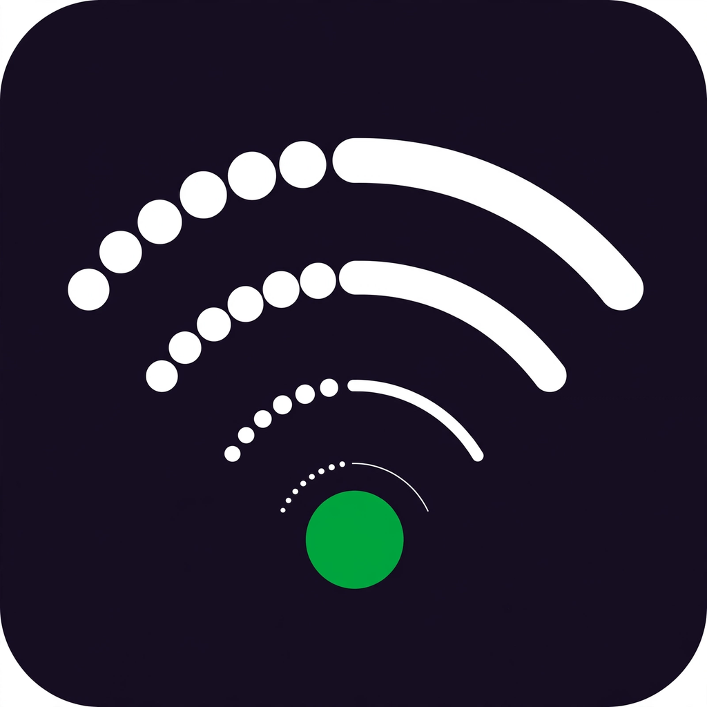

<p align="center">
  
</p>

# Airplane

*the feed that works in airplane mode.*

[](https://github.com/bunnysayzz/airplane/actions/workflows/ci.yml)
[](https://github.com/bunnysayzz/airplane/actions/workflows/codeql.yml)
[](LICENSE)
[](https://github.com/bunnysayzz/airplane/releases)

**Airplane** is an open-source Android app: an anonymous, location-based
public feed that works over a phone-to-phone Bluetooth mesh and, when the
internet is available, public Nostr relays. No accounts, no phone numbers,
no servers, no Google services. Built for protests, concerts, and anywhere
the network is gone.

Posts are ranked by **views, not likes**: what people actually see rises,
what nobody sees dies out.

## One feed, hybrid transport

There is **one feed**. No tabs, no separate destinations.

"World" is not a place you post to. It is a *status* a post earns when a
copy of it reaches the relay network:

- **Mesh-only** posts show no icon. This is the default, and it is clean
  on purpose.
- **World-confirmed** posts show a tiny 🌐. The icon means something
  because it is rare.

Every post is signed on-device with your Ed25519 key and sent over every
transport available at the same time:

- **BLE mesh**: always on. Phones relay posts hop-by-hop (controlled
  flood, TTL 7) whether or not the internet exists.
- **Nostr relays**: when the phone is online (tracked with NetInfo, no
  Google Play Services). The app pushes unsynced posts, pulls new events,
  and checks relays for its unconfirmed event IDs.

Dedup is by event ID (SHA-256 of the signed bytes), identical across BLE
and Nostr, so a post arriving twice is one post.

**Silent background uplink.** When your phone is online and receives a
post that is not yet World-confirmed, it uploads the exact signed bytes
to relays: silently, in the background, with no approval and no prompts.
Relays cannot modify a post (the signature covers the full payload); they
can only copy it. Onboarding says this once, then never again:

> "Posts you send may reach the wider network through other phones."

There is no local-only post. If you post, assume it can reach the world.
The old opt-in World gate was a false promise (mesh is already
broadcast), so it was removed.

## Status

Stated honestly: what has actually run on a real device, and what has
not. Labels: Verified (real device), Code done (device check pending),
Unverified.

| Item | Status | Evidence |
|---|---|---|
| App launches (ExpoLinking crash) | Verified, fixed in v0.1.0 | Alive on real phones: BrowserStack Pixel 8 Pro, pCloudy Pixel 9 Pro XL |
| Publishing throws (Hermes `crypto.getRandomValues`) | Verified, fixed in v0.1.2 | No publish error dialog on any real device since; polyfill imported first in entry |
| Post shows in feed (viewer-cell scoping) | Verified 2026-10-25 | pCloudy Galaxy M53, v0.1.3: test post shown as top post, no error dialog |
| Post survives app restart | Verified 2026-10-25 | Kobiton Galaxy S25: post survived full Close-all plus relaunch and stayed in feed |
| Unit and integration tests | Green at branch head | 507 tests, tsc clean (6 projects), eslint 0/0 |
| Key rotation (T8) | Code done, device check pending | Implemented 2026-10-26, commit `aa330d5d`; real-device rotation check pending |
| Connectivity toggle (T3) | Code done, device check pending | Single connectivity funnel implemented; real-device online/offline toggle check still to run |
| DM send (P1) | Send verified both ways, receipt unverified | Kobiton two-device session 2026-10-25; receipt confirmed neither direction |
| Star counts | Code done, restart resets counts | Counts are in-memory only today; SQLite persistence pending (T17 follow-up) |
| Reshare counts | Restart resets counts, relay ingress pending | Kind-5 ingress not wired; rehydration gap open (T19 follow-up) |
| In-app updater (T14) | Detection seen on device, install flow check pending | 0.1.7 update prompt appeared during the 2026-10-25 smoke test |
| BLE radio interop (two phones) | Unverified | Lab sessions showed 0 nearby on both sides (lab isolation, inconclusive); gold-standard test needs two physical phones in range, internet off |

## Install

Sideload-first. The threat model includes store takedowns, so stores are
not the primary channel.

**Android:** install the APK from
[GitHub Releases](https://github.com/bunnysayzz/airplane/releases).
Current known-good build:

- **v0.1.8**:
  [`airplane-v0.1.8.apk`](https://github.com/bunnysayzz/airplane/releases/download/v0.1.8/airplane-v0.1.8.apk)
  plus
  [`SHA256SUMS.txt`](https://github.com/bunnysayzz/airplane/releases/download/v0.1.8/SHA256SUMS.txt).
  Verify the download against the checksums before installing. This APK
  is hash-identical to the build smoke-tested on a real phone.

Android will warn about unknown sources. That is expected for a sideloaded
app. Import the releases page in
[Obtainium](https://obtainium.imranr.dev/) for updates. Install only
from the official releases page, never from forwarded files or mirrors
you cannot verify.

**iOS:** no public build yet. CI produces an unsigned IPA artifact for
AltStore testing (free Apple ID, 7-day expiry, your own iPhone only).
Signed builds need Apple Developer enrollment, which is pending. Note
also that iOS background BLE is OS-crippled (Apple throttles background
advertising and scanning hard), so iOS participates opportunistically;
Android is the relay backbone.

## Build from source

Prerequisites: **Node 24** (pinned via `.nvmrc`), npm.

```bash
git clone https://github.com/bunnysayzz/airplane.git
cd airplane
npm install
npm test            # full Jest suite
npm run typecheck   # strict tsc --noEmit across all 6 projects
npm run lint        # eslint, zero warnings allowed
```

Run the app:

```bash
cd apps/mobile
npx expo start      # scan the QR code with Expo Go, or press `a` / `i` for an emulator
```

Android release APK (the route release builds actually use; EAS is not
used):

```bash
cd apps/mobile/android
./gradlew assembleRelease -PreactNativeArchitectures=arm64-v8a --no-daemon
```

The `android/` directory is committed; no Expo prebuild runs in CI.
Release APKs are attached to GitHub Releases by
[`.github/workflows/publish-test-apk.yml`](.github/workflows/publish-test-apk.yml).
Release builds are debug-signed today; a production keystore is pending
(T12). See [`docs/release-runbook.md`](docs/release-runbook.md) for the
release pipeline.

## Features

- **Text posts**: 280 Unicode chars (NFC-normalized), append-only, no
  edits.
- **Anonymous by design**: no accounts, no phone numbers. Posts are
  signed with a locally generated Ed25519 key that never leaves your
  device.
- **Location-scoped feed**: posts from your geohash-5 cell (about
  4.9 km by 4.9 km) plus its 8 neighbours. Raw coordinates are never
  stored.
- **Ranked by views, not likes**: `score = log10(1+views) /
  (ageHours+2)^1.5`. Log scaling dampens Sybil gaming; one countable
  view per (device, post, UTC day).
- **Offline mesh relay**: BLE GATT controlled flood (TTL 7 hops, 50 to
  500 ms relay jitter, 10k-entry seen-cache dedup), fragmented into
  frames of at most 469 bytes.
- **Store-and-forward**: posts live on-device in SQLite; your post
  propagates when peers show up. Being alone is the normal case, not an
  error.
- **Connectivity-aware transport**: NetInfo wiring starts Nostr and
  WorldSync when online and stops them when offline; BLE keeps running
  either way.
- **Memorable anonymous names**: feed shows
  "<adjective> <noun>·<pubkey prefix>" instead of "anon·xxxx", derived
  deterministically from the already-public pubkey.
- **Key rotation**: Settings holds an Identity page for burn and
  rotation, with the authorship-abandonment and DM-address-change
  consequences stated in the UI (device check pending, see Status).
- **Star**: public endorsement (signed reference events); counts are
  partial lower bounds, never fed into ranking, and reset on restart
  until SQLite persistence lands.
- **Direct messages (P1)**: sealed relay DMs to post authors (inbox and
  requests folder, block and mute, local-only delete). Send verified;
  receipt unverified (see Status).
- **Reshare**: collapsed cluster on the original card, never duplicate
  cards; reshare-of-reshare flattens to the original. Restart resets the
  count until the rehydration fix lands.
- **Delete your own posts**: deletions are tombstone events the network
  honors.
- **No backend**: no server to deploy, rate-limit, subpoena, or take
  down.
- **Anonymous, not encrypted**: post *contents* are public by design
  (anyone in radio range can read them, like shouting in a square).
  What is protected is your *identity*. The app never promises
  encryption.

## Architecture

Strict layering, one-way dependencies:

```
apps/mobile (React Native + Expo)
  → packages/transport (BLE + Nostr hybrid, WorldSync)
  → packages/protocol (signed CBOR events, flood engine, ranking, geohash)
  → packages/storage (StorePort / KvPort / DatabasePort)
  → packages/crypto (Ed25519)
  → packages/mesh-sim (in-memory radio for tests + dev)
```

Data flow for one post: compose, create, sign (Ed25519), fragment (frames
of at most 469 bytes), flood (TTL 7, jitter 50 to 500 ms, seen-cache LRU
10k), verify, save, receipts, rank, list, render.

Wire truth lives in [`docs/spec/`](docs/spec/): wire format, flood
rules, BLE GATT details. Protocol constants (TTL, frame budget, ranking
exponent, cell precision) are defined in
[`packages/protocol/src/events/types.ts`](packages/protocol/src/events/types.ts)
and documented in the spec, not duplicated here.

## Documentation

- [`docs/blueprint/hybrid-single-feed-plan.md`](docs/blueprint/hybrid-single-feed-plan.md):
  the single-feed hybrid design (current)
- [`docs/blueprint/ARCHITECTURE.md`](docs/blueprint/ARCHITECTURE.md):
  headline decisions, scope, requirements
- [`docs/blueprint/SYSTEM_DESIGN.md`](docs/blueprint/SYSTEM_DESIGN.md):
  layers, node inventory, data model, contracts
- [`docs/blueprint/DIAGRAMS.md`](docs/blueprint/DIAGRAMS.md): diagram set,
  sequence flows
- [`docs/blueprint/ROADMAP.md`](docs/blueprint/ROADMAP.md): phased plan
  with acceptance criteria
- [`docs/blueprint/OPERATIONS.md`](docs/blueprint/OPERATIONS.md):
  operations notes
- [`docs/spec/`](docs/spec/): wire format, flood, BLE GATT (source of
  truth for `packages/protocol`)
- [`docs/threat-model.md`](docs/threat-model.md): security posture
  (draft)
- [`docs/release-runbook.md`](docs/release-runbook.md): how releases get
  cut and published
- [`docs/assumption-register.md`](docs/assumption-register.md): open
  assumptions and their owners
- [`docs/adr/`](docs/adr/): architecture decision records (template in
  place; records to be added as protocol decisions land)

## Repository structure

```
airplane/
├── apps/
│   └── mobile/            # Expo app: feed, composer, settings, onboarding, services
│       ├── app/           # expo-router: (tabs)/feed, (tabs)/messages, (tabs)/settings, post/[id]
│       ├── services/      # airplane services: feed, composer, transport, storage adapters
│       └── android/       # committed Android project (no prebuild in CI)
├── packages/
│   ├── protocol/          # @airplane/protocol: events, CBOR codec, flood, ranking, geohash
│   ├── storage/           # @airplane/storage: ports, schema, op-sqlite/MMKV drivers
│   ├── crypto/            # @airplane/crypto: Ed25519
│   ├── transport/         # @airplane/transport: BLE + Nostr hybrid, WorldSync
│   └── mesh-sim/          # @airplane/mesh-sim: in-memory radio for tests + dev
├── docs/                  # blueprint, spec, adr, threat-model, release-runbook
├── scripts/               # repo tooling (incl. native-module payload gate)
├── .github/workflows/     # ci.yml, build-apk-no-eas.yml, publish-test-apk.yml, ...
├── .nvmrc                 # Node 24
├── CONTRIBUTING.md        # dev setup, commit style, PR bar
├── SECURITY.md            # disclosure policy, supported versions
├── PRIVACY.md             # privacy posture
├── LICENSE                # Apache-2.0
└── CHANGELOG.md           # release notes per release
```

CI runs lint, typecheck, and the full Jest suite on every push and PR;
CodeQL and dependency review run on schedule; release builds cut from
tags. See [`docs/release-runbook.md`](docs/release-runbook.md) for the
release pipeline.

## Contributing

See [CONTRIBUTING.md](CONTRIBUTING.md): dev setup, conventional commits,
PR bar. Good first issues are marked on the issue tracker. Read the
design docs above before proposing protocol changes (anything touching
`TransportPort` or the wire format needs an ADR).

## Security

See [SECURITY.md](SECURITY.md) for the disclosure policy and supported
versions. [`docs/threat-model.md`](docs/threat-model.md) is a draft.
Report vulnerabilities via GitHub Security Advisories, never as public
issues.

## FAQ

**Is it anonymous?**
No accounts, no phone numbers, no analytics. Posts are signed with a
locally generated Ed25519 key that never leaves your device. That makes
you *pseudonymous per key*, not untraceable: BLE radio fingerprints
exist, and v1 does not claim traffic-analysis resistance. Raw
coordinates are never stored; only the geohash-5 cell (about 4.9 km by
4.9 km).

**Does every post reach the world?**
Assume yes. Any online phone can silently relay your post to Nostr
relays. There is no local-only post. Onboarding says so once, plainly.

**Does it need the internet?**
No. Discovery, relay, storage, and ranking all happen between phones
over BLE. The app is designed for the network being gone. Internet only
adds the relay leg.

**What about battery?**
Mesh relay runs while the app is in the foreground with duty-cycled
scanning and advertising. Background relay without Google services is
best-effort (Doze throttles it); measured battery numbers on physical
phones are still open work.

**What are the iOS limits?**
iOS background BLE is OS-crippled: Apple throttles background
advertising and scanning hard, and iOS to Android background discovery
over pure BLE is effectively impossible. So the honest design is
foreground-first mesh. Android is the relay backbone, iOS participates
opportunistically. Note also Apple's Feb-2026 Guideline 1.2, which
explicitly targets anonymous chat and broadcast apps, so store review is
a real risk, hence the sideload-first distribution.

**How are posts moderated?**
There is no central server, so there are no takedowns. You can delete
your *own* posts (tombstone events the network honors). Spam without
identity is rate-limits plus TTL only. Residual abuse is accepted and
documented rather than wished away.

**What happens if there are no peers around?**
Store-and-forward: your post is signed and stored locally, and the flood
resumes the moment a peer appears. The mesh is asynchronous by design.
Being alone is the normal case, not an error.

## License

Apache-2.0. See [LICENSE](LICENSE).

## Acknowledgments

Design references and prior art, all verified open:

- [Bitchat](https://github.com/permissionlesstech/bitchat) (Unlicense,
  public domain): iOS BLE-mesh flood design; the closest shipped
  reference for controlled flooding
- [Nostr](https://github.com/nostr-protocol/nostr): signed-event
  structure and `["e", ...]` tag conventions informed our event model
- [Reticulum](https://reticulum.network): protocol ideas for resilient,
  infrastructure-independent networking

UI adapted from MIT-licensed open source (see [NOTICE](NOTICE) for
details):

- [Pugdon](https://github.com/cajuuh/pugdomv2) (MIT, copyright cajuuh):
  theme system, i18n infrastructure, TabBar, TopBar, Timeline, Thread,
  Settings, Setup screens, compose sheet, dialog host, and UI primitives;
  rebranded to Airplane and re-driven by `services/airplane`
- [panel-ui](https://github.com/panel-ui/panelui) (MIT, copyright
  panel-ui): component primitives vendored via the panel-ui CLI, basis
  for shared UI in `components/ui`
