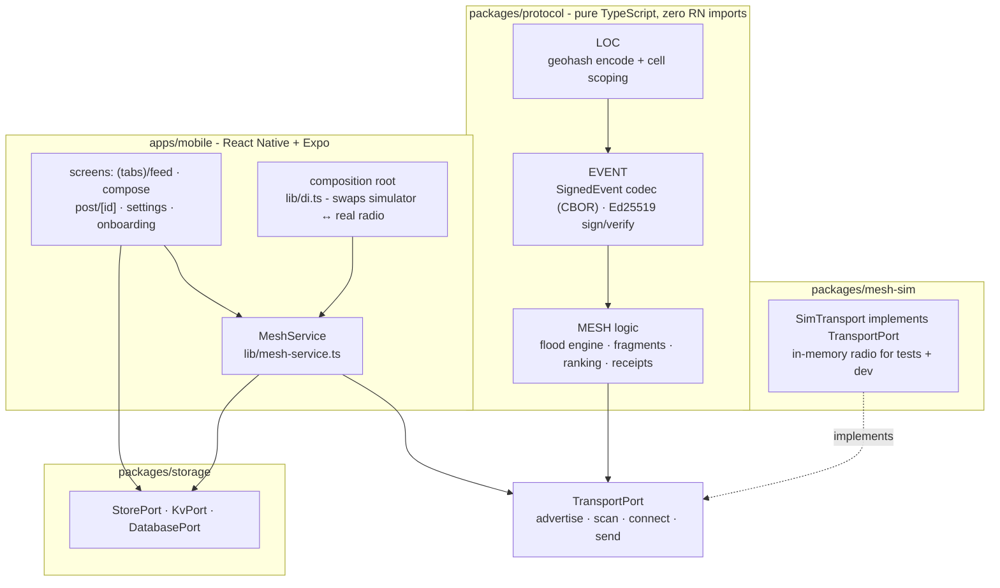

# Airplane

*the feed that works in airplane mode.*

[](https://github.com/bunnysayzz/airplane/actions/workflows/ci.yml)
[](https://github.com/bunnysayzz/airplane/actions/workflows/codeql.yml)
[](LICENSE)
[](https://github.com/bunnysayzz/airplane/releases)

**Airplane** is an open-source iOS + Android app: an anonymous, location-based **public broadcast feed** that works fully offline over a phone-to-phone Bluetooth mesh. Phones store-and-forward signed posts with no server, no accounts, and no internet - built for protests, concerts, and anywhere the network is gone.

It has two feeds: **Around you** - the mesh feed, always working, geohash-scoped, zero internet needed - and **World** - when your phone has internet, posts relayed in from meshes everywhere else, each tagged with where it came from. Any phone in a mesh with internet can uplink *opt-in* posts to public relays; the mesh never depends on them.

Unlike social feeds, posts are ranked by **views, not likes**: what people are actually seeing rises, what isn't dies out.

## Features

v1 scope, stated honestly:

- **Text-only posts** - 280 Unicode chars (NFC-normalized), append-only, no edits
- **Anonymous by design** - no accounts, no phone numbers; posts are signed with a locally-generated Ed25519 key that never leaves your device
- **Location-scoped feed** - posts are tagged to a geohash cell (precision 5, ≈4.9 km × 4.9 km); raw coordinates are never stored
- **Ranked by views, not likes** - `score = log₁₀(1+views) / (ageHours+2)^1.5`; log scaling dampens Sybil gaming
- **Offline mesh relay** - phones relay posts over BLE GATT via a controlled flood (TTL 7 hops, 50–500 ms relay jitter, 10k-entry seen-cache dedup)
- **Store-and-forward** - posts live on-device in SQLite; your post propagates when peers show up
- **Delete your own posts** - deletions are tombstone events the network honors
- **No backend** - there is no server to deploy, rate-limit, subpoena, or take down
- **World feed (opt-in uplink)** - mark a post for the world at compose time and any online phone can relay it to public Nostr relays; relays are untrusted dumb pipes (your signature proves authorship, they can't forge). Default: local mesh only - a local post never silently goes global
- **Anonymous, not encrypted** - post *contents* are public by design (anyone in radio range can read them, like shouting in a square); what is protected is your *identity*. The app says this plainly; it never promises encryption

## How it works

Your phone advertises its presence over Bluetooth LE and scans for neighbors. When you post, the phone signs the event with your device key, splits it into ≤469-byte fragments (11-byte header, 458 bytes payload each), and broadcasts it. Nearby phones verify the signature, relay it onward hop-by-hop after a small random jitter - a *controlled flood* - and dedupe anything they've already seen. Each phone keeps the events in local storage and re-ranks its feed by views as signed view receipts arrive. Phones are the network: the crowd is the server.

The full protocol detail lives in [`docs/spec/`](docs/spec/) (wire format + flood spec).

## Architecture

Strict layering - the dependency direction is one-way and never upward:



The platform seams cross TypeScript **port interfaces** defined in `@airplane/protocol` and `@airplane/storage`:

| Interface | Package | One-line job |
|---|---|---|
| `TransportPort` | `packages/protocol` | BLE contract: advertise, scan, connect, send frames |
| `CryptoPort` | `packages/protocol` | Ed25519 sign/verify/keygen adapter |
| `StorePort` | `packages/storage` | Events, receipts, peers, feed query, pruning |
| `KvPort` | `packages/storage` | Hot key/value state (cursors, flags, prefs - never secrets) |
| `DatabasePort` | `packages/storage` | Low-level SQL behind the SQLite driver |

The current build ships in-memory implementations (`MemoryEventStore`, `MemoryKv`); the native op-sqlite / MMKV drivers are written against the same ports and get linked in P2/P3.

**Data flow (one post, end to end):**

```
compose → createPost → signEvent (Ed25519) → fragmentEvent (≤469 B frames)
→ flood (TTL 7, jitter 50–500 ms, seen-cache LRU 10k)
→ verifyEvent → saveEvent → receipts → rankPosts → listFeed → render
```

### Packages

| Package | Responsibility |
|---|---|
| `apps/mobile` | Expo app: feed UI, composer, post detail, settings, onboarding; DI-swappable mesh wiring |
| `packages/protocol` | Wire truth: signed CBOR events, flood engine, fragmentation, view-receipt dedup, views ranking, geohash |
| `packages/storage` | Port interfaces + schema + in-memory impls; op-sqlite/MMKV native drivers behind ports |
| `packages/mesh-sim` | In-memory `TransportPort` network (latency/loss knobs) so mesh behavior is testable without radios |

**Protocol constants** (from [`packages/protocol/src/events/types.ts`](packages/protocol/src/events/types.ts)):

| Constant | Value | Meaning |
|---|---|---|
| `PROTO_VER` | 1 | Wire version; unknown versions rejected |
| `DEFAULT_TTL` | 7 | Flood hop limit |
| `FLOOD_JITTER_MS_*` | 50–500 | Uniform relay jitter before forwarding |
| `SEEN_LRU_CAP` | 10000 | Deduplication cache size (event ids) |
| `MAX_CONTENT_CHARS` | 280 | Post length limit (Unicode chars, NFC-normalized) |
| `MAX_EVENT_BYTES` | 4096 | Max CBOR-encoded event size |
| `GEOHASH_PRECISION` | 5 | Location cell ≈ 4.9 km × 4.9 km |
| `RANK_GRAVITY` | 1.5 | Time-decay exponent in the ranking formula |
| `FRAG_WIRE_MAX` / `FRAG_HEADER_LEN` | 469 / 11 | BLE frame budget: 458 B payload per fragment |
| `REASSEMBLY_TIMEOUT_MS` | 30000 | Incomplete fragment buffers are dropped |
| `RECEIPT_DAY_BUCKET_S` | 86400 | One countable view per (device, post, UTC day) |

Event kinds: `1 = post`, `2 = view receipt`, `3 = tombstone`. Wire encoding is the 8-position CBOR array `[id, pubkey, created_at, kind, geohash, tags, content, sig]` - see [`docs/spec/wire-format.md`](docs/spec/wire-format.md).

**Deep design docs** (unchanged from the original design pass; `spec/` and `adr/` supersede them as code evolves):

- [`docs/blueprint/ARCHITECTURE.md`](docs/blueprint/ARCHITECTURE.md) - 8 headline decisions, scope, requirements
- [`docs/blueprint/SYSTEM_DESIGN.md`](docs/blueprint/SYSTEM_DESIGN.md) - layers, node inventory, data model, contracts
- [`docs/blueprint/DIAGRAMS.md`](docs/blueprint/DIAGRAMS.md) - Mermaid diagram set, sequence flows
- [`docs/blueprint/ROADMAP.md`](docs/blueprint/ROADMAP.md) - phased plan P0–P6 with acceptance criteria
- [`docs/blueprint/OPERATIONS.md`](docs/blueprint/OPERATIONS.md) - runtime, reliability, failure analysis, ADRs
- [`docs/blueprint/OSS_RESEARCH.md`](docs/blueprint/OSS_RESEARCH.md) - dependency research + selection matrix
- [`docs/spec/`](docs/spec/) - the source of truth for `packages/protocol`

## Tech stack

| Layer | Choice | Version | Status |
|---|---|---|---|
| Mobile framework | React Native + Expo dev build | Expo SDK 53 · RN 0.79.7 · React 19 | Active |
| Navigation | expo-router | 5.1.11 | Active |
| Language | TypeScript (strict) | 5.6 | Active |
| Event codec | cbor-x | 1.x | Active |
| Signatures / hashing | @noble/curves, @noble/hashes | 1.x | Active |
| Local DB | op-sqlite | - | Planned P3 (in-memory `MemoryEventStore` now) |
| Hot KV | react-native-mmkv | - | Planned P2 (in-memory `MemoryKv` now) |
| Feed list | `@shopify/flash-list` | - | Planned P2 (React Native `FlatList` now) |
| Tests | Jest + ts-jest | 29.x | 71/71 passing, 9 suites |
| Workspaces | npm workspaces | `apps/*`, `packages/*` | Active |

## Project status & roadmap

Current phase: **P1 - Foundation** (monorepo, protocol types frozen, simulator transport, Expo skeleton, CI green).

| Phase | Name | One-liner |
|---|---|---|
| **P0** | Radio spike | **The gate:** prove real BLE phone-to-phone relay on 2 Androids + 1 iPhone (discovery ≤15 s, ≥95% fragment success, ≥8 kbps, ≤20%/h battery). No radio, no product. |
| P1 | Foundation | Protocol + storage + simulator + app skeleton + CI (in progress) |
| P2 | Local-only MVP | Feed UI + composer + ranking on simulated data, no radio needed |
| P3 | Mesh MVP | Real flood between 2+ physical phones; view receipts over the mesh |
| P4 | Global relay | Opt-in uplink/downlink via public Nostr relays; "World" feed |
| P5 | Hardening | Background best-effort, battery tuning, dense-crowd congestion, full threat model, moderation story |
| P6 | Distribution | Signed APK/AAB on GitHub Releases, Obtainium updates, TestFlight, launch |

Full acceptance criteria and definitions of done: [`docs/blueprint/ROADMAP.md`](docs/blueprint/ROADMAP.md).

## Getting started

Prerequisites: **Node 24** (repo pins it via `.nvmrc`), npm (bundled with Node).

```bash
git clone https://github.com/bunnysayzz/airplane.git
cd airplane
npm install
npm test            # 9 suites, 71 tests - protocol, storage, mesh-sim
npm run typecheck   # strict tsc --noEmit across all workspaces
npm run lint        # eslint, zero warnings allowed
```

**Run the app** (runs against the in-mesh simulator in P1 - no Bluetooth hardware needed):

```bash
cd apps/mobile
npx expo start      # scan the QR code with Expo Go, or press `a` / `i` for an emulator
```

The app builds its dependency graph in `src/lib/di.ts`; P1 mode is `'simulator'`, which wires an in-process mesh (`SimNetwork`) to the in-memory store. Real BLE wiring lands in P3 and is a one-line mode swap.

**Run a simulated flood** from Node (protocol logic only):

```bash
npx jest packages/mesh-sim   # multi-peer flood tests with latency/loss knobs
```

## Repository structure

```
airplane/
├── apps/
│   └── mobile/            # Expo app - screens, theme, DI seam, mesh service
│       ├── app/           # expo-router: (tabs)/feed, (tabs)/compose, post/[id], settings, onboarding
│       └── src/           # lib/di.ts, lib/mesh-service.ts, bootstrap, lifecycle, config, theme
├── packages/
│   ├── protocol/          # @airplane/protocol - pure TS: events, CBOR codec, Ed25519,
│   │   └── src/           # flood engine, fragments, ranking, receipts, geohash, transport ports
│   ├── storage/           # @airplane/storage - StorePort/KvPort/DatabasePort, schema,
│   │   └── src/           # in-memory impls + op-sqlite/MMKV driver stubs
│   └── mesh-sim/          # @airplane/mesh-sim - SimTransport/SimNetwork in-memory radio
├── docs/
│   ├── blueprint/         # original architecture blueprint (ARCHITECTURE, SYSTEM_DESIGN,
│   │                      # DIAGRAMS, OPERATIONS, OSS_RESEARCH, ROADMAP)
│   ├── spec/              # wire-format.md + flood.md - source of truth for protocol
│   ├── adr/               # architecture decision records
│   ├── release-runbook.md # how releases get cut and published
│   └── threat-model.md    # security posture (P1 DRAFT stub; full model lands in P4)
├── .github/workflows/     # ci.yml (lint+typecheck+test), build-android.yml
│                          # (+ codeql.yml, dependency-review.yml, nightly.yml, release.yml)
├── .nvmrc                 # Node 24
├── CONTRIBUTING.md        # dev setup, commit style, PR bar
├── SECURITY.md            # disclosure policy, supported versions
├── LICENSE                # Apache-2.0
└── CHANGELOG.md           # release notes per release
```

CI runs lint, typecheck, and the full Jest suite on every push/PR; CodeQL and dependency review run on schedule; release builds cut from tags. See [`docs/release-runbook.md`](docs/release-runbook.md) for the release pipeline.

## Releases

We ship sideload-first - the product's threat model includes store takedowns, so stores are not the primary channel:

- **Android:** signed APK (and AAB) attached to [GitHub Releases](https://github.com/bunnysayzz/airplane/releases), with SHA-256 checksums. Import the releases page in [Obtainium](https://obtainium.imranr98.com/) for updates.
- **iOS:** TestFlight builds (once P6 lands).

Install only from the official releases page - Android will warn about unknown sources; that's expected for sideloaded apps. The exact cut-and-publish procedure (tagging, signing, checksums, notes format) is in [`docs/release-runbook.md`](docs/release-runbook.md), and each release's notes land in [`CHANGELOG.md`](CHANGELOG.md).

## Contributing

See [CONTRIBUTING.md](CONTRIBUTING.md) - dev setup, conventional commits, PR bar. Good first issues are marked on the issue tracker. The design docs above are worth reading before proposing protocol changes (anything touching `TransportPort` or the wire format needs an ADR).

## Security

See [SECURITY.md](SECURITY.md) for the disclosure policy and supported versions. Honest state: [`docs/threat-model.md`](docs/threat-model.md) is a **P1 draft stub**; the full threat model lands in P4. Report vulnerabilities via GitHub Security Advisories, never as public issues.

## FAQ

**Is it anonymous?**
No accounts, no phone numbers, no analytics - posts are signed with a locally-generated Ed25519 key that never leaves your device. That makes you *pseudonymous per key*, not untraceable: BLE radio fingerprints exist, and we don't claim traffic-analysis resistance in v1. Raw coordinates are never stored; only the geohash-5 cell (~4.9 km × 4.9 km).

**Does it need the internet?**
No. Discovery, relay, storage, and ranking all happen between phones over BLE. The app is designed for the network being gone.

**What about battery?**
Mesh relay runs while the app is in the foreground with duty-cycled scanning/advertising. The P0 target is ≤20%/h on Android during active relay - that number is an assumption until physical phones validate it, and the target will be updated with measured values.

**What are the iOS limits?**
iOS background BLE is OS-crippled: Apple throttles background advertising/scanning hard, and iOS↔Android background discovery over pure BLE is effectively impossible. So the honest design is **foreground-first mesh** - Android is the relay backbone, iOS participates opportunistically. We document the behavior matrix instead of promising what the OS won't allow. Note also Apple's Feb-2026 Guideline 1.2, which explicitly targets anonymous chat/broadcast apps - store review is a real risk, hence the sideload-first distribution.

**Why views, not likes?**
Likes are cheap, brigadable signals. Views measure actual reach: a post rises only if real devices actually receive and render it. The log₁₀ scaling means the 10,000th view matters far less than the 10th, which dampens Sybil-inflated counts. View receipts are signed and deduped per (device, post, UTC day), and counts are labeled *approximate device counts* - never used for trust or money.

**Is sideloading legal / safe?**
Yes, sideloading is legal. We sign every APK, publish SHA-256 checksums on the releases page, and support Obtainium for verified updates. Only install builds from the official [releases page](https://github.com/bunnysayzz/airplane/releases) - never from forwarded files or mirrors you can't verify.

**How are posts moderated?**
There is no central server, so there are no takedowns. You can delete your *own* posts (tombstone events the network honors). Client-side, hash-based blocklists land in P4. Spam without identity is fundamentally rate-limits + TTL only - residual abuse is accepted and documented rather than wished away.

**What happens if there are no peers around?**
Store-and-forward: your post is signed and stored locally, and the flood resumes the moment a peer appears. The mesh is asynchronous by design - being alone is the normal case, not an error.

## License

Apache-2.0 - see [LICENSE](LICENSE).

## Acknowledgments

Design references and prior art, all verified open:

- [Bitchat](https://github.com/permissionlesstech/bitchat) (Unlicense / public domain) - iOS BLE-mesh flood design; the closest shipped reference for controlled flooding
- [Nostr](https://github.com/nostr-protocol/nostr) - signed-event structure and `["e", …]` tag conventions informed our event model
- [Reticulum](https://reticulum.network) - protocol ideas for resilient, infrastructure-independent networking

UI adapted from MIT-licensed open source (see [NOTICE](NOTICE) for details):

- [Pugdon](https://github.com/cajuuh/pugdomv2) (MIT, © cajuuh) - theme system, i18n infrastructure, TabBar, TopBar, Timeline/Thread/Settings/Setup screens, compose sheet, dialog host, and ui primitives; rebranded to Airplane and re-driven by `services/airplane`
- [panel-ui](https://github.com/panel-ui/panelui) (MIT, © panel-ui) - component primitives vendored via the panel-ui CLI, basis for shared UI in `components/ui`
