# Airplane - Architecture Diagram Mesh (canonical)

> Synthesized 2026-10-10 by the architecture coordinator from the diagram-specialist worker output.
> **v2 re-plan (2026-10-10, Worker 3):** added the RELAY subsystem (RELAY-1…5) + third-party Nostr-relay
> actor; new diagrams C4, G2, I6/I7/I8; security boundary TB3. All stable v1 node IDs unchanged.
> All node IDs are stable and identical to [SYSTEM_DESIGN.md](SYSTEM_DESIGN.md) §1 (63 nodes: 58 v1 + 5 RELAY, verified by script).
> Mermaid was syntax-checked, not rendered - run a renderer pass before publishing.

---

**Status:** engineering reference · **Date:** 2026-10-10 · **Repo:** `enginoor/airplane`
**Source of truth for node IDs:** `SYSTEM_DESIGN.md` §1 (final 63-node registry: 58 v1 + RELAY-1…5). All diagrams below use identical node tokens.

## ID convention & legend

Node tokens are the registry IDs with the hyphen removed (Mermaid-safe), e.g. token `FEED1` =
registry **`FEED-1`**. Every node label carries the exact registry ID, so traceability is preserved
across all diagrams A–P. Five new registry nodes were added in v2 (RELAY-1…5 - see "Registry additions").

| Symbol | Meaning |
|---|---|
| Solid arrow `──▶` | Allowed dependency / data flow (direction = "depends on" / "flows to") |
| Dashed arrow `- -▶` | Carve-out / secondary path (explicitly justified in B) |
| Red dashed `╴╴✕` | PROHIBITED direction (architectural rule violation) |
| `⟨external⟩` label prefix | Outside the app / not a registry node (actors, OS, GitHub) |
| `⟨native⟩` label prefix | Platform native code, touched only via TS interfaces |
| DB cylinder | Persistent store (SQLite table set / MMKV / Keychain-Keystore) |
| `verify-before-render` | Trust boundary marker - bytes cross only after EVENT-2 validation |

### Registry additions

**v2 additions (5):** the opportunistic-global-relay subsystem. All other IDs are the stable v1 registry.

| Node | Name | One-line responsibility |
|---|---|---|
| RELAY-1 | RelayClient | wss pool to third-party Nostr relays; Nostr sessions, publish/subscribe, failover |
| RELAY-2 | UplinkQueue | durable queue of opt-in events pending uplink; retry with backoff |
| RELAY-3 | DownlinkSync | REQ filters + EOSE handling; world-feed ingest via EVENT-2 |
| RELAY-4 | RelayDirectory | default + user relay list; health checks; relay blocklist |
| RELAY-5 | NostrAdapter | mesh signed-event ↔ Nostr envelope (signed with the unlinkable Nostr keypair) |

External actors (User, nearby Peer phones, third-party Nostr relays, GitHub Releases, Obtainium,
TestFlight, EAS, OS) are not registry nodes; they are drawn as `⟨external⟩` entities. Protocol frame
types (`EVENT_FRAG`/`SYNC_HELLO`/`SYNC_WANT`/`SYNC_OFFER`) are wire labels, not nodes.

---

## A. Overall application architecture

_One process, no backend: the phone is the whole system. The only "cloud" is static file hosting
(GitHub Releases) for sideload updates - it never sees user data - plus third-party Nostr relays
(dumb pipes for opt-in posts only). Neither is Airplane infrastructure; Airplane runs no servers._

```mermaid
flowchart TB
    subgraph EXT_PEERS["⟨external⟩ Nearby peers (other Airplane phones)"]
        P1["⟨external⟩ Peer phone A<br/>(BLE GATT: central + peripheral)"]
        P2["⟨external⟩ Peer phone B"]
    end
    USER["⟨external⟩ User<br/>(taps, reads, posts)"]

    subgraph PHONE["This phone - single app process (no server, no containers)"]
        subgraph APP_L["APP - composition root"]
            APP1["APP-1 AppEntry<br/>(boot sequence, DI graph)"]
            APP2["APP-2 NavigationHost"]
            APP3["APP-3 AppLifecycle<br/>(fg/bg state machine)"]
            APP4["APP-4 ConfigService<br/>(protocol constants)"]
            APP5["APP-5 BackgroundCoordinator"]
            APP6["APP-6 PermissionGate"]
        end
        subgraph UI_L["UI - presentation (renders only)"]
            UI1["UI-1 FeedScreen"]
            UI2["UI-2 ComposerSheet"]
            UI3["UI-3 PostDetailScreen"]
            UI4["UI-4 MeshStatusIndicator"]
            UI5["UI-5 SettingsScreen"]
            UI6["UI-6 OnboardingFlow"]
            UI7["UI-7 ThemeI18nShell"]
        end
        subgraph DOMAIN["FEED - domain (ranking/views/scoping/publishing)"]
            FEED1["FEED-1 FeedStore"]
            FEED2["FEED-2 RankingEngine"]
            FEED3["FEED-3 ViewTracker"]
            FEED4["FEED-4 GeohashScoper"]
            FEED5["FEED-5 PostPublisher"]
            FEED6["FEED-6 TombstoneManager"]
        end
        subgraph EVT["EVENT - signed event model (trust boundary)"]
            EVENT1["EVENT-1 EventBuilder"]
            EVENT2["EVENT-2 EventVerifier<br/>verify-before-render"]
            EVENT3["EVENT-3 CborCodec"]
            EVENT4["EVENT-4 Lz4Codec"]
            EVENT5["EVENT-5 EventBus"]
            EVENT6["EVENT-6 CanonicalSerializer"]
        end
        subgraph MESHN["MESH - BLE transport (opaque bytes only)"]
            MESH1["MESH-1 MeshEngine"]
            MESH2["MESH-2 FloodRouter"]
            MESH3["MESH-3 Fragmenter"]
            MESH4["MESH-4 Reassembler"]
            MESH5["MESH-5 PeerDiscovery"]
            MESH6["MESH-6 ConnectionManager"]
            MESH7["MESH-7 GattTransport"]
            MESH8["MESH-8 StoreForwardSync"]
            MESH9["MESH-9 PowerManager"]
            MESH10["MESH-10 MtuRegistry"]
            MESH11["MESH-11 BroadcastScheduler"]
            MESH12["MESH-12 BleNativeModule<br/>⟨native⟩ TurboModule → IBleAdapter"]
        end
        subgraph CRYPT["CRYPTO - key custody (leaf)"]
            CRYPTO1["CRYPTO-1 KeyManager<br/>(private key never leaves)"]
            CRYPTO2["CRYPTO-2 Ed25519Ops"]
            CRYPTO3["CRYPTO-3 PeerIdRotator"]
        end
        subgraph RELAYN["RELAY - opportunistic global relay (L4b, pure TS)"]
            RELAY1["RELAY-1 RelayClient<br/>(wss pool; Nostr sessions)"]
            RELAY2["RELAY-2 UplinkQueue<br/>(opt-in events; durable)"]
            RELAY3["RELAY-3 DownlinkSync<br/>(REQ → world feed)"]
            RELAY4["RELAY-4 RelayDirectory<br/>(relay list + health)"]
            RELAY5["RELAY-5 NostrAdapter<br/>(envelope sign/parse)"]
        end
        subgraph STOREN["STORE - persistence (leaf)"]
            STORE1["STORE-1 Database<br/>(op-sqlite, WAL)"]
            STORE2["STORE-2 EventRepository"]
            STORE3["STORE-3 PeerRepository"]
            STORE4["STORE-4 MigrationRunner"]
            STORE5["STORE-5 FragmentBuffer"]
            STORE6["STORE-6 HotState<br/>(MMKV)"]
            STORE7["STORE-7 RetentionJanitor"]
        end
        subgraph LOCOBS["Cross-cutting"]
            LOC1["LOC-1 LocationService<br/>(raw coords never stored)"]
            LOC2["LOC-2 GeohashUtil"]
            OBS1["OBS-1 Logger<br/>(ring buffer, redacted)"]
            OBS2["OBS-2 MeshMetrics"]
            OBS3["OBS-3 CrashAdapter<br/>(opt-in → GlitchTip)"]
        end
        subgraph BUILDN["DIST - tooling (build-time only)"]
            DIST1["DIST-1 BuildPipeline<br/>(EAS profiles)"]
            DIST2["DIST-2 SideloadPackager"]
        end
    end

    subgraph SECSTORE["⟨external⟩ Platform secure storage"]
        KS["⟨native⟩ Keychain (iOS) / Keystore (Android)<br/>Ed25519 identity private key"]
    end
    subgraph GHOSTUFF["⟨external⟩ Distribution only - NOT a backend (no user data)"]
        GHREL["GitHub Releases<br/>(signed APK/IPA + SHA256SUMS)"]
        OBTAIN["Obtainium<br/>(Android update tracker)"]
        TF["TestFlight / App Store / Play<br/>(iOS + optional store tracks)"]
        EAS["EAS Build (CI)"]
    end
    subgraph NOSTRNET["⟨external⟩ Third-party Nostr relays - NOT Airplane infra (untrusted dumb pipes)"]
        NR["wss://relay… (anyone-run)<br/>sees: public opt-in posts + courier IP"]
    end

    USER --> UI1
    USER --> UI2
    UI1 --> FEED1
    FEED1 --> EVENT2
    FEED5 --> MESH1
    FEED5 -->|"opt-in posts only<br/>(default OFF)"| RELAY2
    RELAY2 --> RELAY1
    RELAY4 -.->|"relay list + health"| RELAY1
    RELAY5 -.->|"envelope codec"| RELAY1
    RELAY1 <-->|"Nostr EVENT/REQ/CLOSE/EOSE<br/>(relays UNTRUSTED - dumb pipes)"| NR
    RELAY3 -->|"inbound → verify-before-render"| EVENT2
    MESH12 <-->|"BLE GATT frames<br/>EVENT_FRAG / SYNC_*<br/>(signed, opaque bytes)"| P1
    MESH12 <--> P2
    CRYPTO1 --> KS
    MESH1 --> MESH12
    APP1 -.->|"wires (composition root)"| UI1
    APP1 -.-> FEED1
    APP1 -.-> MESH1
    APP1 -.-> RELAY1
    APP1 -.-> STORE1
    APP1 -.-> CRYPTO1
    DIST1 --> EAS
    EAS --> GHREL
    GHREL --> OBTAIN
    GHREL --> TF
    PHONE -.->|"in-app update check<br/>(poll releases/latest, weekly)"| GHREL
    OBS3 -.->|"opt-in crash envelopes<br/>only when online"| GHOSTUFF

    style GHOSTUFF fill:#f5f5f5,stroke-dasharray: 5 5
    style SECSTORE fill:#fff3e0
```

---

## B. Architecture dependency graph

_The strict rule is UI → FEED → EVENT → {MESH, STORE}; nothing depends upward; native code only
via TS interfaces (`IBleAdapter`, `IDatabase`, `IHotState`, `ISecureStore`, `ILocationProvider`).
Five carve-outs exist (dashed): FEED→MESH-1 publish-only, MESH→EVENT inbound-verify,
FEED-4 as a shared scope-policy leaf, FEED→RELAY-1 uplink/world-feed-only, RELAY→EVENT inbound-verify.
Circular-dependency check: NONE - see note below._

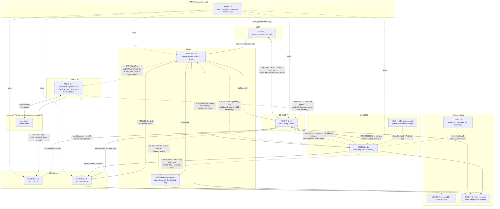

**Circular-dependency verification (manual trace, 2026-10-10):**
- Candidate cycle 1: `MESH-2 → FEED-4 → ?` - FEED-4 depends only on LOC-1/2. No path back to MESH. ✕ no cycle.
- Candidate cycle 2: `FEED-3/5/6 → MESH-1 → MESH-2 → FEED-4` - FEED-4 does not depend on FEED-3/5/6. ✕ no cycle.
- Candidate cycle 3: `MESH → EVENT-2 → STORE-2` - STORE-2 is a leaf. ✕ no cycle.
- Candidate cycle 4: `EVENT-2 → FEED-4 → LOC-1` - LOC-1 depends on nothing in-app. ✕ no cycle.
- Candidate cycle 5 (v2): `RELAY-1 → EVENT-2 → STORE-2` - STORE-2 is a leaf. ✕ no cycle.
- Candidate cycle 6 (v2): `FEED-1 → RELAY-1 → ?` - RELAY depends on EVENT/STORE/CRYPTO only (never FEED); world-feed reads flow FEED-1 → STORE-2, not back into RELAY. ✕ no cycle.
- **Result: no circular dependencies.** FEED-4 stays acyclic only because it is policy-pure (no
  MESH/EVENT/STORE imports) - enforce with an import lint rule.
- **Prohibited directions restated:** nothing depends on APP (it is the root, depended on by none);
  UI depends only on FEED (+ OBS-2 read, APP-2 nav); native modules are consumed exclusively through
  their TS interfaces (TEST-1/TEST-2 swap the implementation without touching callers);
  RELAY never ranks, renders, or mints mesh events (mirrors the MESH prohibitions).

---

## C. Detailed component graphs

_One subsystem per box, every one of the 58 registry nodes shown exactly once. Split into three
diagrams for readability: C1 = UI+FEED+APP · C2 = MESH+EVENT+CRYPTO · C3 = STORE+LOC+OBS+DIST+TEST._

### C1. UI + FEED + APP components

```mermaid
flowchart TB
    subgraph UI_S["UI (L1) - depends on FEED-1 (+FEED-3 hook), OBS-2, APP-2 only"]
        UI1["UI-1 FeedScreen<br/>(FlashList; impressions → FEED-3)"]
        UI2["UI-2 ComposerSheet<br/>(≤280 chars; offline-first submit)"]
        UI3["UI-3 PostDetailScreen<br/>(live view count; own-post delete)"]
        UI4["UI-4 MeshStatusIndicator<br/>(1 Hz OBS-2 snapshot)"]
        UI5["UI-5 SettingsScreen<br/>(identity, retention, power, export/wipe)"]
        UI6["UI-6 OnboardingFlow<br/>(permissions, offline explainer, keygen)"]
        UI7["UI-7 ThemeI18nShell<br/>(dark-first tokens, i18n)"]
    end
    subgraph FEED_S["FEED (L2) - the domain; never knows BLE/SQL"]
        FEED1["FEED-1 FeedStore<br/>IFeedStore: UI-facing facade"]
        FEED2["FEED-2 RankingEngine<br/>pure: log10(1+v)/(age_h+2)^1.5"]
        FEED3["FEED-3 ViewTracker<br/>impression ≥1.5s/50% → receipt"]
        FEED4["FEED-4 GeohashScoper<br/>cell + 8-neighbor ring policy"]
        FEED5["FEED-5 PostPublisher<br/>draft→sign→store→flood; offline queue"]
        FEED6["FEED-6 TombstoneManager<br/>author-only delete (LWW)"]
    end
    subgraph APP_S["APP (L0) - composition root"]
        APP1["APP-1 AppEntry<br/>boot: config→migrate→key→db→wire"]
        APP2["APP-2 NavigationHost<br/>airplane://post/‹id› deep links"]
        APP3["APP-3 AppLifecycle<br/>fg/bg → MESH-9 duty policy"]
        APP4["APP-4 ConfigService<br/>PROTO_VER, TTL=7, jitter…"]
        APP5["APP-5 BackgroundCoordinator<br/>Android 15-min sync burst"]
        APP6["APP-6 PermissionGate<br/>BLE + location permission UX"]
    end

    UI1 --> FEED1
    UI1 --> FEED3
    UI2 --> FEED5
    UI2 --> FEED4
    UI3 --> FEED1
    UI3 --> FEED6
    UI4 --> OBS2
    UI5 --> CRYPTO1
    UI5 --> APP4
    UI5 --> MESH9
    UI5 --> STORE1
    UI6 --> APP6
    UI6 --> CRYPTO1
    UI7 -.-> UI1
    APP2 --> FEED1
    FEED1 --> FEED2
    FEED1 --> FEED4
    FEED1 --> STORE2
    FEED1 --> EVENT5
    FEED3 --> EVENT1
    FEED3 --> STORE2
    FEED3 --> MESH1
    FEED3 --> CRYPTO1
    FEED4 --> LOC1
    FEED4 --> LOC2
    FEED5 --> EVENT1
    FEED5 --> EVENT2
    FEED5 --> STORE2
    FEED5 --> MESH1
    FEED6 --> EVENT1
    FEED6 --> STORE2
    FEED6 --> MESH1
    FEED6 --> CRYPTO1
    APP1 -.->|"constructs"| UI1
    APP1 -.->|"constructs"| FEED1
    APP1 -.->|"constructs"| APP2
    APP3 --> MESH1
    APP3 --> MESH9
    APP5 --> MESH1
    APP6 --> MESH1
    APP4 --> STORE6

    OBS2["OBS-2 MeshMetrics<br/>(cross-cutting sink)"]
    CRYPTO1["CRYPTO-1 KeyManager"]
    LOC1["LOC-1 LocationService"]
    LOC2["LOC-2 GeohashUtil"]
    STORE1["STORE-1 Database"]
    STORE2["STORE-2 EventRepository"]
    STORE6["STORE-6 HotState (MMKV)"]
    EVENT1["EVENT-1 EventBuilder"]
    EVENT2["EVENT-2 EventVerifier"]
    EVENT5["EVENT-5 EventBus"]
    MESH1["MESH-1 MeshEngine"]
    MESH9["MESH-9 PowerManager"]
```

### C2. MESH + EVENT + CRYPTO components

```mermaid
flowchart TB
    subgraph MESH_S["MESH (L4) - moves opaque bytes; relays never sign"]
        MESH1["MESH-1 MeshEngine<br/>facade: start/stop order, publish(), injectRelay()"]
        MESH2["MESH-2 FloodRouter<br/>seen? TTL? scope? → jittered rebroadcast"]
        MESH3["MESH-3 Fragmenter<br/>event → 11B-header frames ≤469B"]
        MESH4["MESH-4 Reassembler<br/>frames → bytes; 30s timeout/GC"]
        MESH5["MESH-5 PeerDiscovery<br/>advertise+scan; rotating-id guard"]
        MESH6["MESH-6 ConnectionManager<br/>pool cap 5; backoff 1/2/4/8s"]
        MESH7["MESH-7 GattTransport<br/>IGattTransport: RX/TX/ID chars"]
        MESH8["MESH-8 StoreForwardSync<br/>HELLO/WANT/OFFER catch-up"]
        MESH9["MESH-9 PowerManager<br/>performance/balanced/saver + degraded"]
        MESH10["MESH-10 MtuRegistry<br/>per-peer ATT MTU (default 23)"]
        MESH11["MESH-11 BroadcastScheduler<br/>timer wheel; per-peer cap 64"]
        MESH12["MESH-12 BleNativeModule<br/>⟨native⟩ IBleAdapter impl"]
    end
    subgraph EVENT_S["EVENT (L3) - the signed-event trust boundary"]
        EVENT1["EVENT-1 EventBuilder<br/>buildPost/buildReceipt/buildTombstone"]
        EVENT2["EVENT-2 EventVerifier<br/>cheap→expensive check order"]
        EVENT3["EVENT-3 CborCodec<br/>8-position canonical array"]
        EVENT4["EVENT-4 Lz4Codec<br/>≥64B only; magic 0x4C5A"]
        EVENT5["EVENT-5 EventBus<br/>verified/stored/dropped pub-sub"]
        EVENT6["EVENT-6 CanonicalSerializer<br/>sha256 → event id (consensus-critical)"]
    end
    subgraph CRYPTO_S["CRYPTO (L5) - leaf; secrets never cross upward"]
        CRYPTO1["CRYPTO-1 KeyManager<br/>Keychain/Keystore; sign inside"]
        CRYPTO2["CRYPTO-2 Ed25519Ops<br/>@noble/curves wrappers"]
        CRYPTO3["CRYPTO-3 PeerIdRotator<br/>HMAC-epoch id, 15-min rotation"]
    end

    MESH1 --> MESH2
    MESH1 --> MESH3
    MESH1 --> MESH4
    MESH1 --> MESH5
    MESH1 --> MESH6
    MESH1 --> MESH7
    MESH1 --> MESH8
    MESH1 --> MESH9
    MESH2 --> MESH11
    MESH2 --> STORE2
    MESH2 --> FEED4
    MESH3 --> EVENT3
    MESH3 --> EVENT4
    MESH3 --> MESH10
    MESH4 --> EVENT2
    MESH4 --> STORE5
    MESH5 --> MESH12
    MESH5 --> MESH9
    MESH5 --> STORE3
    MESH5 --> CRYPTO3
    MESH6 --> MESH12
    MESH6 --> MESH7
    MESH6 --> MESH10
    MESH6 --> STORE3
    MESH7 --> MESH12
    MESH7 --> MESH10
    MESH8 --> STORE2
    MESH8 --> STORE3
    MESH8 --> MESH3
    MESH8 --> MESH7
    MESH8 --> EVENT2
    MESH8 --> FEED4
    MESH9 --> MESH5
    MESH11 --> MESH6
    MESH11 --> MESH7
    MESH4 -.->|"verified bytes → relay decision"| MESH2
    EVENT1 --> EVENT6
    EVENT1 --> EVENT3
    EVENT1 --> CRYPTO1
    EVENT1 --> CRYPTO2
    EVENT2 --> EVENT3
    EVENT2 --> EVENT6
    EVENT2 --> CRYPTO2
    EVENT2 --> STORE2
    EVENT2 --> FEED4
    EVENT5 -.-> FEED1
    EVENT5 -.-> OBS2
    CRYPTO3 --> MESH5

    STORE2["STORE-2 EventRepository"]
    STORE3["STORE-3 PeerRepository"]
    STORE5["STORE-5 FragmentBuffer"]
    FEED1["FEED-1 FeedStore"]
    FEED4["FEED-4 GeohashScoper"]
    OBS2["OBS-2 MeshMetrics"]
```

### C3. STORE + LOC + OBS + DIST + TEST components

```mermaid
flowchart TB
    subgraph STORE_S["STORE (L6) - leaf; only platform drivers below"]
        STORE1["STORE-1 Database<br/>op-sqlite; WAL; tx() helper; wipe()"]
        STORE2["STORE-2 EventRepository<br/>idempotent inserts; feed queries"]
        STORE3["STORE-3 PeerRepository<br/>peers + sync cursors + MTU hints"]
        STORE4["STORE-4 MigrationRunner<br/>user_version-gated; failure = fatal"]
        STORE5["STORE-5 FragmentBuffer<br/>reassembly spillover; 60s TTL"]
        STORE6["STORE-6 HotState<br/>typed MMKV wrapper (no secrets)"]
        STORE7["STORE-7 RetentionJanitor<br/>15-min purge; VACUUM >10MB freed"]
    end
    subgraph LOC_S["LOC - cross-cutting; consumed by FEED/MESH"]
        LOC1["LOC-1 LocationService<br/>GPS → geohash-5; raw coords dropped"]
        LOC2["LOC-2 GeohashUtil<br/>encode/neighbors/valid (ngeohash)"]
    end
    subgraph OBS_S["OBS - cross-cutting sink; depends on nothing"]
        OBS1["OBS-1 Logger<br/>1000-entry ring; allowlisted fields only"]
        OBS2["OBS-2 MeshMetrics<br/>tx/rx/dedup/drop/peer counters"]
        OBS3["OBS-3 CrashAdapter<br/>queue offline; flush when online"]
    end
    subgraph DIST_S["DIST - build tooling (never ships in-app logic)"]
        DIST1["DIST-1 BuildPipeline<br/>EAS dev/sideload-apk/sideload-ipa"]
        DIST2["DIST-2 SideloadPackager<br/>artifacts + .sha256 + RELEASES.md"]
    end
    subgraph TEST_S["TEST - implement the same TS interfaces"]
        TEST1["TEST-1 SimulatorTransport<br/>in-memory IGattTransport; N-node sim"]
        TEST2["TEST-2 BleFakes<br/>scripted IBleAdapter fake"]
        TEST3["TEST-3 EventFixtures<br/>deterministic keypair + vectors"]
        TEST4["TEST-4 FloodHarness<br/>storm/churn/scopeLeak scenarios"]
    end

    STORE2 --> STORE1
    STORE3 --> STORE1
    STORE4 --> STORE1
    STORE5 --> STORE1
    STORE7 --> STORE1
    STORE7 --> STORE2
    STORE7 --> STORE5
    OBS1 -.->|"persisted tail (200 rows)"| STORE1
    STORE6 -.->|"⟨native⟩ MMKV JSI"| STORE1
    TEST1 -.->|"implements"| MESH7
    TEST2 -.->|"implements"| MESH12
    TEST3 -.->|"drives"| EVENT2
    TEST4 -.->|"drives"| TEST1
    TEST4 -.->|"drives"| MESH2
    DIST1 --> DIST2
    APP1 -.->|"installs at boot"| OBS3
    APP1 -.->|"runs before mesh"| STORE4

    MESH7["MESH-7 GattTransport (IGattTransport)"]
    MESH12["MESH-12 BleNativeModule (IBleAdapter)"]
    MESH2["MESH-2 FloodRouter"]
    EVENT2["EVENT-2 EventVerifier"]
    APP1["APP-1 AppEntry"]
```

**A/B/C consistency check:** every edge in C1–C4 respects the layer rule from B
(UI only touches FEED/OBS-2/APP-2; FEED touches EVENT/STORE/LOC/MESH-1-publish/FEED-4/RELAY-1-uplink;
MESH touches EVENT-verify/STORE/FEED-4/IBleAdapter; RELAY touches EVENT-verify/STORE/CRYPTO-Nostr-key;
EVENT touches CRYPTO/STORE/FEED-4; STORE/CRYPTO are leaves). The only cross-layer write to OBS-1's persisted tail goes via
STORE-1 (single documented exception to "OBS depends on nothing").

### C4. RELAY components (new in v2)

_The internet half of the product: opt-in uplink and world-feed downlink. RELAY never touches BLE;
mesh events cross into it only through EVENT-2 (inbound verify) and FEED-5's opt-in flag (outbound).
World posts (`source='world'`) are never admitted to the mesh flood._

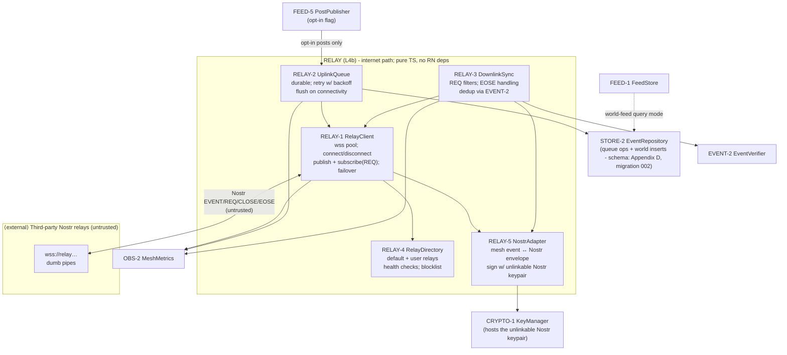

---

## D. Class / interface diagrams

_Domain models are immutable value objects; services sit behind interfaces at every
layer/native seam so TEST doubles swap without ripple. DI boundaries: APP-1 constructs the
`AppGraph`; UI consumes `IFeedStore` only._

### D1. Domain models (owned by EVENT-3/EVENT-6; consumed everywhere)

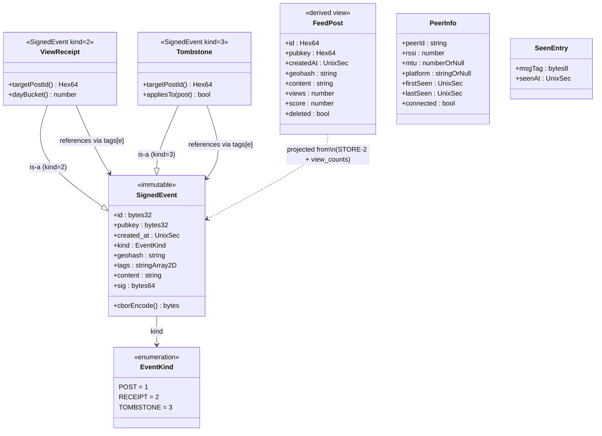

### D2. Service interfaces & DI boundaries

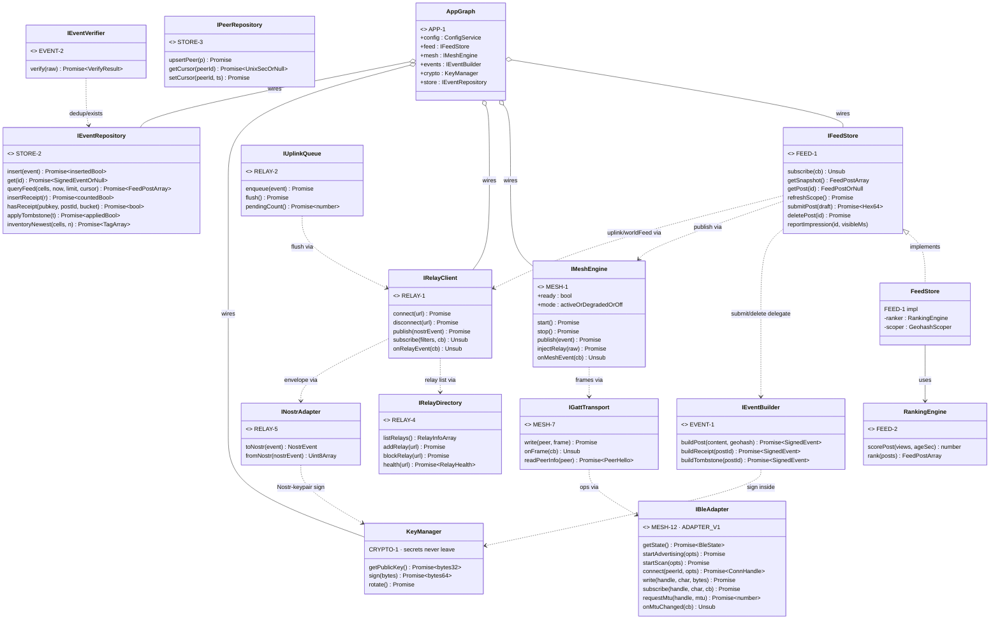

**DI/test seams:** `SimulatorTransport` (TEST-1) implements `IGattTransport`; `BleFakes`
(TEST-2) implement `IBleAdapter`; `EventFixtures` (TEST-3) produce `SignedEvent`s with a fixed
non-secret keypair. APP-1's `AppGraph` is the only place implementations are chosen.

---

## E. Runtime & process topology

_One OS process. The JS thread owns policy; native threads own I/O. The IPC mechanism is the
React Native bridge/JSI (TurboModule events) - labeled on every crossing._

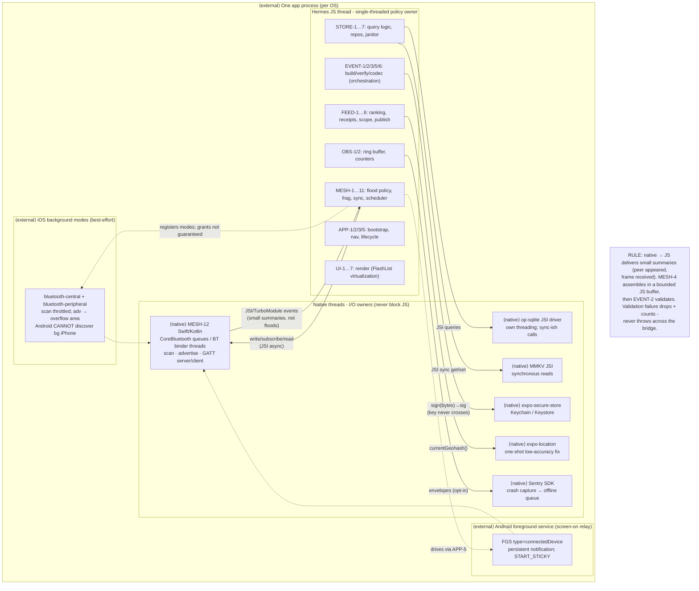

---

## F. Deployment topology

_There is deliberately NO server. "Deployment" = build pipeline + static artifact hosting.
Phones never talk to our infrastructure at runtime._

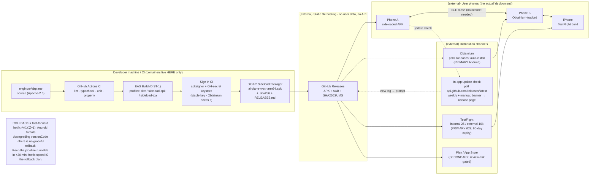

---

## G. Data architecture

_SQLite is the durable source of truth; MMKV is hot ephemeral state; Keychain/Keystore holds
exactly one secret. Retention is TTL-driven (STORE-7); caches are bounded and rebuildable._

```mermaid
flowchart TB
    subgraph SQLITE["SQLite (STORE-1 op-sqlite, WAL) - DDL per SYSTEM_DESIGN.md App. D"]
        T_EVENTS[("events<br/>id PK · pubkey · kind(1/2/3)<br/>created_at · geohash(5)<br/>tags(CBOR) · content · sig<br/>received_at · expires_at · deleted")]
        T_RECEIPTS[("receipts<br/>PK(pubkey, post_id, day_bucket)<br/>event_id UNIQUE")]
        T_VC[("view_counts<br/>post_id PK · views<br/>DERIVED - recomputed on migrate")]
        T_PEERS[("peers<br/>peer_id PK · first/last_seen<br/>rssi · mtu(hint) · platform")]
        T_SYNC[("sync_state<br/>peer_id PK · cursor_ts<br/>last_hello_at")]
        T_SEEN[("seen<br/>msg_tag PK · seen_at<br/>dedup spillover, 7d")]
        T_FRAG[("frag_buf<br/>PK(msg_tag, idx)<br/>reassembly spillover, 60s")]
        T_LOGS[("logs<br/>ts · level · tag · msg<br/>OBS-1 tail (200 rows)")]
    end
    subgraph MMKVK["MMKV (STORE-6 HotState) - typed keys; NO secrets"]
        K_GH["lastGeohash"]
        K_CFG["powerMode · retentionH<br/>locale · theme<br/>config overrides"]
        K_DRAFT["draftPost (7d TTL)"]
        K_MISC["onboarded · lastBgRun"]
    end
    subgraph KEYSTORE["⟨native⟩ Keychain/Keystore (CRYPTO-1 only)"]
        K_ID["Ed25519 identity private key<br/>(THE one secret)"]
        K_EPOCH["peer-id epoch key (MMKV ok -<br/>not identity; unlinkable)"]
    end
    subgraph REPOS["Repository interfaces (only writers)"]
        R2["STORE-2 EventRepository<br/>events · receipts · view_counts"]
        R3["STORE-3 PeerRepository<br/>peers · sync_state"]
        R5["STORE-5 FragmentBuffer<br/>frag_buf"]
        R7["STORE-7 RetentionJanitor<br/>purge expired"]
    end
    subgraph CACHES["Bounded caches (rebuildable - never load-bearing)"]
        C_SEEN["SeenCache LRU 10k<br/>(memory + seen spillover)"]
        C_RANK["Feed ranking window<br/>(FEED-1 memory; ≤2000 posts)"]
        C_REASM["Reassembly buffers<br/>(MESH-4; 64KB/peer cap)"]
        C_MTU["MtuRegistry map<br/>(MESH-10; renegotiated)"]
    end

    R2 --> T_EVENTS
    R2 --> T_RECEIPTS
    R2 --> T_VC
    R3 --> T_PEERS
    R3 --> T_SYNC
    R5 --> T_FRAG
    R7 --> T_EVENTS
    R7 --> T_SEEN
    R7 --> T_FRAG
    MESH2 -.->|"dedup lookup"| C_SEEN
    C_SEEN -.->|"spillover"| T_SEEN
    FEED1 -.->|"sorted window"| C_RANK
    MESH4 -.->|"partial frames"| C_REASM
    C_REASM -.->|"large msgs"| T_FRAG
    EVENT2 -.->|"EXISTS(id)?"| T_EVENTS
    FEED3 -.->|"hasReceipt()?"| T_RECEIPTS
    STORE4 -.->|"migrations 001…; PRAGMA user_version"| T_EVENTS
    STORE4 -.->|"RECOMPUTE view_counts"| T_VC
    APP4 -.->|"retentionH override"| K_CFG
    FEED4 -.->|"last-known cell fallback"| K_GH
    CRYPTO1 --> K_ID
    CRYPTO3 --> K_EPOCH

    MESH2["MESH-2 FloodRouter"]
    FEED1["FEED-1 FeedStore"]
    FEED3["FEED-3 ViewTracker"]
    FEED4["FEED-4 GeohashScoper"]
    MESH4["MESH-4 Reassembler"]
    EVENT2["EVENT-2 EventVerifier"]
    STORE4["STORE-4 MigrationRunner"]
    APP4["APP-4 ConfigService"]
    CRYPTO1["CRYPTO-1 KeyManager"]
    CRYPTO3["CRYPTO-3 PeerIdRotator"]

    noteG["RETENTION LIFECYCLE: expires_at = created_at + retentionH (default 24h).<br/>Receipts/tombstones share the target's lifetime (tombstone kept ≥ target).<br/>STORE-7 purges every 15 min + on boot; expired events are invisible AND unrelayed<br/>(MESH-2 checks expires_at - do not relay the dead). seen: 7d · peers: 7d inactive · frag_buf: 60s."]
```

### G2. Relay data flows (new in v2)

_Uplink: mesh post → opt-in check → durable queue → Nostr envelope → third-party relays.
Downlink: relay REQ → envelope parse → EVENT-2 verify → world feed, tagged with origin geohash.
Neither flow touches the BLE flood; the mesh never sees world posts._

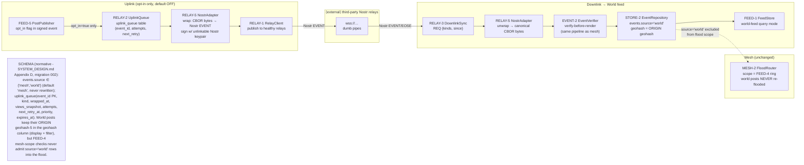

---

---

## H. Event & communication architecture

_Wire protocol: one frame envelope, four frame types. Flood = TTL-decrement + jitter + LRU dedup.
Sync = negentropy-style inventory catch-up. Delivery guarantee, stated honestly: **best-effort
flood, no ACKs, no delivery receipts** - the UI says "relaying…", never "delivered"._

### H1. Frame types & fragment flow

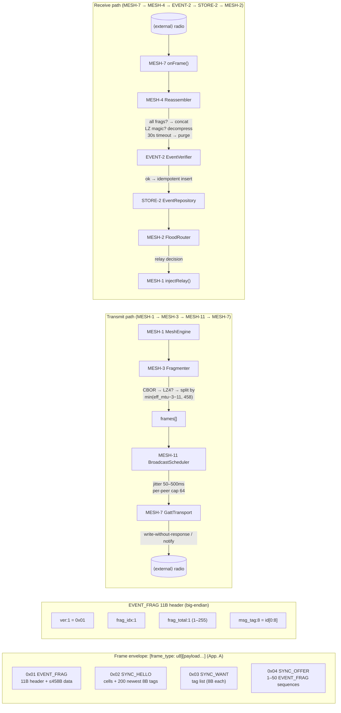

### H2. Flood routing decision (MESH-2) & catch-up sync (MESH-8)

```mermaid
flowchart TB
    subgraph FLOOD["MESH-2 FloodRouter.onVerified(event, ingress) - decision is O(1), pure"]
        D1{"seen(msg_tag)?<br/>(LRU 10k + seen table)"}
        D2{"TTL == 0?"}
        D3{"FEED-4 inScope(geohash)?"}
        D4{"expires_at < now?"}
        SCHED["MESH-11.enqueue()<br/>TTL−1, jitter 50–500ms<br/>all peers EXCEPT ingress"]
        DROP["drop + OBS-2 counter<br/>{dup|ttl|scope|expired}"]
        D1 -->|yes| DROP
        D1 -->|no| D2
        D2 -->|yes| DROP
        D2 -->|no| D3
        D3 -->|no| DROP
        D3 -->|yes| D4
        D4 -->|yes| DROP
        D4 -->|no| SCHED
    end
    subgraph SYNC["MESH-8 StoreForwardSync - per-connection negentropy-style catch-up"]
        S1["onConnect(peer): read cursor (STORE-3)"]
        S2["→ send SYNC_HELLO<br/>{cells, min_ts, 200 newest tags}"]
        S3["← recv peer HELLO<br/>diff = their_tags − my_tags"]
        S4{"diff empty?"}
        S5["←/→ SYNC_WANT(tags)"]
        S6["→ SYNC_OFFER ≤50 newest<br/>in-scope events (frag sequences)"]
        S7["reassemble → EVENT-2 → STORE-2<br/>→ MESH-2 relay decision (TTL decremented)"]
        S8["STORE-3.setCursor(peer, now)"]
        S1 --> S2 --> S3 --> S4
        S4 -->|yes| S8
        S4 -->|no| S5 --> S6 --> S7 --> S8
    end
    subgraph GUAR["Delivery guarantees - honest"]
        G1["BEST-EFFORT flood: no ACKs, no retries to a specific peer"]
        G2["Redundancy comes from MANY relays + MESH-8 sync on every connect"]
        G3["Idempotent everywhere: same bytes 50× cost one dedup lookup"]
        G4["Scope-bounded: out-of-ring events are dropped, never stored/relayed"]
    end
```

---

## I. Critical sequences

### I1. Posting a message end-to-end (compose → sign → store → flood)

```mermaid
sequenceDiagram
    participant U as UI-2 ComposerSheet
    participant FP as FEED-5 PostPublisher
    participant EB as EVENT-1 EventBuilder
    participant KM as CRYPTO-1 KeyManager
    participant EV as EVENT-2 EventVerifier
    participant SR as STORE-2 EventRepository
    participant FS as FEED-1 FeedStore
    participant ME as MESH-1 MeshEngine
    participant FR as MESH-3 Fragmenter
    participant BS as MESH-11 BroadcastScheduler

    U->>FP: submitPost(draft)
    FP->>EV: bounds check (1–280 chars, NFC)
    FP->>EB: buildPost(content, geohash)
    EB->>KM: sign(canonicalBytes)
    Note over KM: private key never leaves CRYPTO-1
    KM-->>EB: sig (64B)
    EB-->>FP: SignedEvent (id = sha256)
    FP->>SR: insert(event) - idempotent
    FP->>FS: optimistic add → feed:updated
    U-->>U: post visible instantly, badge "relaying…"
    FP->>ME: publish(event) - resolves when QUEUED ≤1s
    ME->>FR: fragment(compressed, msgTag, mtu)
    FR-->>ME: frames[] (11B hdr + ≤458B)
    ME->>BS: enqueue(frames, peers, TTL=7)
    Note over BS: jitter 50–500ms per rebroadcast;<br/>NO delivery ack - best effort
```

### I2. Receiving + verifying + rendering a post

```mermaid
sequenceDiagram
    participant GT as MESH-7 GattTransport
    participant RA as MESH-4 Reassembler
    participant EV as EVENT-2 EventVerifier
    participant SR as STORE-2 EventRepository
    participant EB as EVENT-5 EventBus
    participant FS as FEED-1 FeedStore
    participant UI as UI-1 FeedScreen
    participant FL as MESH-2 FloodRouter

    GT->>RA: onFrame(EVENT_FRAG, from)
    RA->>RA: collect by msg_tag; all frags?
    RA->>EV: verify(reassembled bytes)
    Note over EV: cheap→expensive: size→CBOR→kind→<br/>geohash→ts→id==sha256→Ed25519→<br/>tombstone-auth→scope→dedup
    alt valid
        EV-->>RA: ok(event)
        RA->>SR: insert(event) - INSERT OR IGNORE
        SR-->>EB: emit event:stored
        EB->>FS: incremental update
        FS->>FS: rescore via FEED-2; re-sort
        FS-->>UI: feed:updated → re-render
        RA->>FL: onVerified(event, ingress)
        FL->>FL: relay decision (TTL−1, scope)
    else invalid
        EV-->>RA: reject(code)
        RA->>RA: drop + OBS-2 verify_rejects{code}
        Note over RA: one bad datagram; mesh redundancy<br/>delivers valid copies via other paths
    end
```

### I3. View receipt emission + ranking update

```mermaid
sequenceDiagram
    participant UI as UI-1 FeedScreen
    participant VT as FEED-3 ViewTracker
    participant SR as STORE-2 EventRepository
    participant EB as EVENT-1 EventBuilder
    participant ME as MESH-1 MeshEngine
    participant FS as FEED-1 FeedStore

    UI->>VT: onViewableItemsChanged(ids, visibleMs)
    VT->>VT: visible ≥50% for ≥1.5s?
    alt impression qualifies
        VT->>SR: hasReceipt(myPubkey, postId, dayBucket)?
        alt not yet counted today
            VT->>EB: buildReceipt(postId)
            EB-->>VT: SignedEvent kind=2
            VT->>ME: publish(receipt) - TTL=7 flood
            VT->>SR: insertReceipt (PK dedups)
            Note over VT: ≤1 receipt / 2s app-wide (storm guard);<br/>publish failure → drop silently (next impression retries)
        end
    end
    Note over ME,FS: later: receipt arrives via flood (I2 path)
    ME->>SR: insertReceipt → counted=true
    SR->>FS: event:stored(receipt)
    FS->>FS: views = distinct pubkeys; score = log10(1+v)/(age_h+2)^1.5
    FS-->>UI: feed:updated (re-ranked)
```

### I4. Peer discovery + connection + catch-up sync

```mermaid
sequenceDiagram
    participant PD as MESH-5 PeerDiscovery
    participant BA as MESH-12 IBleAdapter
    participant CM as MESH-6 ConnectionManager
    participant GT as MESH-7 GattTransport
    participant SY as MESH-8 StoreForwardSync
    participant SR as STORE-2 EventRepository

    PD->>BA: startAdvertising(serviceUuid, rotatingPeerId)
    PD->>BA: startScan([serviceUuid])
    BA-->>PD: onAdvertisement(peerId, rssi)
    PD->>PD: upsert peer (STORE-3); RSSI smoothing
    PD->>CM: ensureConnected(peer)
    CM->>BA: connect(peerId, timeout 10s)
    alt connected
        CM->>GT: discoverService + subscribe(TX_CHAR)
        GT->>GT: readPeerInfo (ID_CHAR: peerId‖protoVer‖mtu)
        GT-->>SY: onConnect(peer)
        SY->>SR: getCursor(peer) + inventoryNewest(cells, 200)
        SY->>GT: write SYNC_HELLO
        GT-->>SY: onFrame(SYNC_HELLO from peer)
        SY->>SY: diff tags → SYNC_WANT or direct OFFER
        SY->>GT: write SYNC_OFFER (≤50 events, frag sequences)
        Note over SY: receiver: reassemble → EVENT-2 → STORE-2 → MESH-2 relay
        SY->>SY: setCursor(peer, now)
    else connect fails / timeout
        CM->>CM: backoff 1/2/4/8s + jitter; pool cap 5
        Note over CM: link-loss preserves cursor - resume is cheap
    end
```

### I5. Failure path - corrupt event rejected (trust boundary in action)

```mermaid
sequenceDiagram
    participant AT as ⟨external⟩ Adversary / buggy peer
    participant GT as MESH-7 GattTransport
    participant RA as MESH-4 Reassembler
    participant EV as EVENT-2 EventVerifier
    participant OB as OBS-2 MeshMetrics

    AT->>GT: EVENT_FRAG (bit-flipped sig / forged tombstone / oversize)
    GT->>RA: onFrame(frame)
    RA->>RA: header parse; bad header → drop + counter
    RA->>EV: verify(bytes)
    EV->>EV: id == sha256(canonical)? Ed25519.verify?
    alt BAD_SIG / BAD_ID / NOT_AUTHOR / OVERSIZE …
        EV-->>RA: reject(code) - a VALUE, not a throw
        RA->>OB: incr verify_rejects{code}
        RA->>RA: drop frame; never reaches STORE-2, never renders
        Note over RA: attacker spends THEIR battery;<br/>our integrity is untouched
        alt repeat offender
            EV->>OB: per-key throttle counter
        end
    end
    Note over AT,OB: Timeouts on this path: reassembly 30s → purge;<br/>verify is CPU-bounded (≤5ms p99 target) - no retries, invalid is invalid.
```

### I6. Global relay round-trip (post → mesh → uplink → relay → downlink → world feed)

_The full v2 product loop: an opt-in post travels the local mesh, gets uplinked by an online peer,
and appears in a distant viewer's World feed. Every relay crossing is untrusted._

```mermaid
sequenceDiagram
    participant U as UI-2 ComposerSheet (author)
    participant FP as FEED-5 PostPublisher
    participant ME as MESH-1 MeshEngine
    participant PEER as ⟨external⟩ Peer phone (online)
    participant UQ as RELAY-2 UplinkQueue (peer)
    participant RC as RELAY-1 RelayClient (peer)
    participant NR as ⟨external⟩ Nostr relay
    participant DS as RELAY-3 DownlinkSync (viewer)
    participant EV as EVENT-2 EventVerifier
    participant SR as STORE-2 EventRepository
    participant FS as FEED-1 FeedStore
    participant UI as UI-1 FeedScreen (viewer, World tab)

    U->>FP: submitPost(draft, uplinkOptIn=true)
    Note over U: opt-in toggle default OFF;<br/>copy: "public everywhere, not encrypted"
    FP->>ME: publish(event) - mesh flood (I1 path)
    ME->>PEER: flood → peer stores event (opt_in flag intact)
    PEER->>UQ: enqueue(event) - opt_in=true only
    UQ->>RC: flush() when online
    RC->>RC: RELAY-5 wrap → Nostr EVENT<br/>sign w/ unlinkable Nostr keypair
    RC->>NR: ["EVENT", nostrEvent]
    Note over NR: relay is a dumb pipe;<br/>sees courier IP + public post
    NR-->>DS: ["EVENT", …] (viewer subscribed w/ REQ)
    DS->>DS: RELAY-5 unwrap → canonical CBOR bytes
    DS->>EV: verify(bytes) - same pipeline as mesh (I2)
    EV-->>DS: ok(event)
    DS->>SR: insert(event, source='world')
    SR-->>FS: event:stored
    FS->>FS: world-feed rank (origin geohash tag)
    FS-->>UI: World tab shows post + "Delhi · via relay"
```

### I7. Offline viewer - Around-you only

_No internet means no World feed, ever: the mesh product is fully intact and the UI says so
honestly instead of spinning._

```mermaid
sequenceDiagram
    participant UI as UI-1 FeedScreen
    participant DS as RELAY-3 DownlinkSync
    participant FS as FEED-1 FeedStore
    participant ME as MESH-1 MeshEngine

    UI->>DS: worldFeed.refresh()
    DS->>DS: connectivity? none
    DS-->>UI: skip subscribe - no retry spin
    UI->>UI: banner: "offline - World feed unavailable"
    UI->>FS: getSnapshot(scope=aroundYou)
    FS-->>UI: mesh posts render (unchanged)
    ME->>ME: flood continues (BLE unaffected)
    Note over UI,ME: relay subsystem dormant costs zero battery;<br/>uplink queue persists for later
```

### I8. Relay failure fallback - mesh unaffected

_Relays are third-party and flaky; a dead relay degrades only the World feed, never the mesh.
Failover is silent and bounded._

```mermaid
sequenceDiagram
    participant RC as RELAY-1 RelayClient
    participant RD as RELAY-4 RelayDirectory
    participant UQ as RELAY-2 UplinkQueue
    participant NR1 as ⟨external⟩ Relay A (down)
    participant NR2 as ⟨external⟩ Relay B (healthy)
    participant ME as MESH-1 MeshEngine
    participant OB as OBS-2 MeshMetrics

    RC->>NR1: ["EVENT", …]
    NR1--xRC: timeout / 4xx / blocked
    RC->>RD: markUnhealthy(A, reason)
    RD-->>RC: next healthy relay: B
    RC->>NR2: ["EVENT", …]
    NR2-->>RC: OK
    RC->>OB: incr relay_failover{from=A,to=B}
    alt all relays down
        RC->>UQ: keep queued; backoff 1/2/4/8…60m
        RC->>RC: single "World feed degraded" indicator
        Note over RC: NO error storm; NO mesh impact
    end
    ME->>ME: flood continues independently
    Note over ME: mesh and relay are separate failure domains<br/>by construction (no shared code path)
```

---

---

## J. State & lifecycle diagrams

### J1. App lifecycle (APP-3 → MESH-9 duty policy)

```mermaid
stateDiagram-v2
    [*] --> ColdStart: process launch
    state ColdStart {
        [*] --> LoadConfig: APP-4 read MMKV
        LoadConfig --> RunMigrations: APP-1
        RunMigrations --> UnlockKeys: CRYPTO-1 getOrCreate
        UnlockKeys --> OpenDb: STORE-1
        OpenDb --> WireGraph: APP-1 AppGraph
        WireGraph --> InstallCrash: OBS-3
        InstallCrash --> [*]
    }
    ColdStart --> PermissionCheck: APP-6
    PermissionCheck --> MeshOff: denied → degraded banner
    PermissionCheck --> MeshReady: granted
    state MeshReady {
        [*] --> Active: APP-3 foreground
        Active --> Degraded: APP-3 background
        Degraded --> Active: foreground again
        Degraded --> Suspended: iOS suspend / OEM kill
        Suspended --> Active: relaunch (best-effort)
    }
    MeshReady --> MeshOff: BLE off / revoked
    MeshOff --> MeshReady: re-enabled → resume
    MeshReady --> Killed: OS kill
    MeshOff --> Killed: OS kill
    Killed --> ColdStart: next launch (integrity check if unclean)
    note right of MeshReady
        Foreground-first: iOS background relay is
        documented-degraded, never faked.
        Feed always reads from STORE when mesh is off.
    end note
```

### J2. Peer connection states (MESH-5 + MESH-6)

```mermaid
stateDiagram-v2
    [*] --> Discovered: adv seen (MESH-5 scan)
    Discovered --> Connecting: MESH-6 ensureConnected
    Connecting --> Connected: GATT ok (≤10s)
    Connecting --> Backoff: TIMEOUT / GATT_ERROR
    Backoff --> Connecting: 1/2/4/8s + jitter
    Backoff --> Cooldown: 3 attempts failed → 5-min cooldown
    Cooldown --> Discovered: re-advertised
    Connected --> Syncing: MESH-8 onConnect (HELLO/WANT/OFFER)
    Syncing --> Idling: cursor set
    Idling --> Syncing: new HELLO / new local events
    Idling --> Connected: keepalive
    Connected --> Disconnected: idle >60s → prune
    Connected --> LinkLost: onDisconnect
    LinkLost --> Backoff: cursor preserved (STORE-3)
    Disconnected --> [*]: peer lost (3 missed windows → STORE-3 markLost)
    Discovered --> [*]: peer lost
```

### J3. Sync session states (MESH-8, per connection)

```mermaid
stateDiagram-v2
    [*] --> HelloSent: onConnect → send SYNC_HELLO
    HelloSent --> HelloReceived: peer HELLO arrives
    HelloReceived --> Diffing: compute their_tags − my_tags
    Diffing --> WantSent: diff ≠ ∅ → SYNC_WANT
    Diffing --> OfferPrepared: peer wants from us → assemble ≤50
    WantSent --> Offering: peer sends SYNC_OFFER
    Offering --> Verifying: reassemble → EVENT-2 per event
    Verifying --> RelayDecision: valid → STORE-2 → MESH-2
    RelayDecision --> CursorUpdated: STORE-3.setCursor
    OfferPrepared --> CursorUpdated: OFFER written
    CursorUpdated --> [*]
    HelloSent --> Aborted: garbage / oversize → keep conn for flood
    WantSent --> Aborted: timeout
    Aborted --> [*]
    note right of Aborted
        Sync failure never kills the connection:
        flood relay continues independently.
    end note
```

---

## K. Security architecture

_Trust boundaries, in order: (1) wire→EVENT-2 verify-before-render, (2) CRYPTO-1 key custody,
(3) BLE link (unauthenticated - public by design), (4) relays (v2: third-party Nostr relays -
untrusted dumb pipes). What's NOT protected in v1 is labeled honestly._

```mermaid
flowchart TB
    subgraph Z0["⟨external⟩ UNTRUSTED: radio / peers"]
        ADV["adversary in range:<br/>reads posts (public by design)<br/>injects invalid frames<br/>observes timing/RSSI"]
    end
    subgraph TB1["TRUST BOUNDARY 1 - verify-before-render (EVENT-2)"]
        direction LR
        WIRE["wire bytes"]
        V1["size ≤4096"]
        V2["CBOR 8-array shape"]
        V3["kind ∈ {1,2,3}"]
        V4["geohash valid"]
        V5["ts ∈ [now−ret−skew, now+300s]"]
        V6["content bounds"]
        V7["id == sha256(canonical)"]
        V8["Ed25519.verify"]
        V9["tombstone authorship"]
        V10["FEED-4 scope"]
        V11["dedup"]
        WIRE --> V1 --> V2 --> V3 --> V4 --> V5 --> V6 --> V7 --> V8 --> V9 --> V10 --> V11
    end
    subgraph Z1["TRUSTED: app interior (post-verify)"]
        STORE["STORE-2: only verified rows"]
        UI["UI-1/3: renders verified rows as TEXT"]
    end
    subgraph TB2["TRUST BOUNDARY 2 - key custody (CRYPTO-1)"]
        direction LR
        KM["CRYPTO-1 KeyManager"]
        SEC["⟨native⟩ Keychain/Keystore<br/>private key at rest"]
        SIGN["sign(bytes)→sig INSIDE<br/>key never crosses to JS logic"]
        KM --> SEC
        KM --> SIGN
    end
    subgraph Z2["Privacy mechanisms (not crypto guarantees)"]
        ROT["CRYPTO-3: 15-min rotating BLE peer ids<br/>(HMAC-epoch; unlinkable to pubkey)"]
        NOCORD["LOC-1: raw coords → geohash-5 in a local var;<br/>never persisted, never logged"]
        NOADV["adv packet: service UUID + 8B peer id only<br/>no device name, no pubkey"]
    end
    subgraph TB3["TRUST BOUNDARY 3 - relays (v2; RELAY-1…5)"]
        direction LR
        RU["relays: UNTRUSTED<br/>may drop/censor/reorder;<br/>may serve invalid events"]
        RV["EVENT-2 verify on downlink<br/>invalid → drop (same as mesh)"]
        RS["cannot forge authorship<br/>(Ed25519 mesh sig)"]
        RK["cannot link mesh identity<br/>to Nostr keypair (separate)"]
        RU --> RV --> RS --> RK
    end
    subgraph NOTP["NOT protected in v1 - labeled honestly"]
        T1["traffic analysis (who publishes when)"]
        T2["Sybil views: receipts are cheap; ranking is gameable<br/>(mitigated: 24h dedup, log-scale scoring, per-key rate limits)"]
        T3["BLE link-layer tracking via timing/RSSI"]
        T4["signed events by one key are linkable by content graph<br/>(unavoidable for dedup/tombstones; disclosed in UI-6)"]
        T5["relay operator sees courier IP + uplink timing<br/>(disclosed in UI-6; VPN/Tor out of scope v1)"]
        T6["relay spam in world feed (mitigated: filtering hooks<br/>RELAY-4/5 + local mute; residual accepted)"]
    end

    ADV -->|"frames"| TB1
    TB1 -->|"verified events only"| Z1
    Z1 -->|"build →"| TB2
    TB2 -->|"signed bytes"| ADV
    RELAY1 -->|"Nostr EVENT/REQ<br/>(courier IP visible)"| TB3
    TB3 -->|"verified events only"| Z1
    Z2 -.-> TB1
    NOTP -.->|"documented, not hand-waved"| Z1

    noteK["INPUT RULES: CBOR decode in try/catch → schema validate → verify → store.<br/>Fuzz the boundary (TEST-3 adversarial corpus + fast-check).<br/>Log redaction: NEVER content, pubkey, peerId, coordinates (lint-enforced)."]
```

---

## L. Build & delivery

_Source → CI (lint/typecheck/test) → EAS build → sign → GitHub Release → Obtainium/TestFlight.
Rollback = fast-forward hotfix; Android forbids downgrades._

```mermaid
flowchart LR
    subgraph SRC["Source"]
        CODE["enginoor/airplane<br/>tag vX.Y.Z"]
    end
    subgraph CI["GitHub Actions CI (DIST-1)"]
        LINT["biome check +<br/>eslint react-hooks"]
        TYPE["tsc --noEmit<br/>(strict)"]
        UNIT["jest: unit + RNTL<br/>protocol pure-TS"]
        PROP["fast-check: flood invariants<br/>TTL↓, dedup converges"]
        SIM["TEST-1 sim: 3-peer flood<br/>converges, no dup past TTL"]
        LINT --> TYPE --> UNIT --> PROP --> SIM
    end
    subgraph BUILD["Build (DIST-1 EAS)"]
        EAS["eas build<br/>sideload-apk / sideload-ipa<br/>versionCode monotonic ✓"]
    end
    subgraph REL["Release (DIST-2)"]
        SIGNC["apksigner + GH-secret keystore<br/>verify + shred (always)"]
        PKGR["package-sideload.sh<br/>airplane-‹ver›-arm64.apk<br/>.sha256 · RELEASES.md"]
        GHR2["GitHub Release<br/>APK + AAB + SHA256SUMS"]
    end
    subgraph OUT["Channels"]
        OBT2["Obtainium<br/>(primary Android)"]
        IAC2["in-app checker<br/>(secondary)"]
        TF2["TestFlight<br/>(primary iOS)"]
    end

    CODE --> CI
    SIM --> EAS
    EAS --> SIGNC --> PKGR --> GHR2
    GHR2 --> OBT2
    GHR2 --> TF2
    GHR2 -.-> IAC2

    noteL["ROLLBACK: no downgrade path (Android blocks lower versionCode).<br/>Recovery = fast-forward hotfix vX.Y.Z+1 through this same pipeline<br/>(Obtainium picks it up ~6h). Keep pipeline <30 min (warm cache)."]
```

---

## M. Observability

_On-device first, privacy-constrained: ring buffer + opt-in crash reporting to a SELF-HOSTED
GlitchTip. NO cloud analytics - ever (hard product constraint)._

```mermaid
flowchart TB
    subgraph EMIT["Emitters (every node)"]
        E1["OBS-1 log(level, tag, msg, SafeFields)<br/>allowlisted fields ONLY"]
        E2["OBS-2 metrics.incr()<br/>tx/rx/dedup/ttl/scope/reject/peer/sync/receipt"]
    end
    subgraph LOCAL["On-device (always on, no network)"]
        RING["OBS-1 ring buffer (1000)<br/>tail 200 → SQLite logs table"]
        MET["OBS-2 counters<br/>1 Hz snapshot → UI-4 pill"]
        DIAG["Diagnostics screen<br/>(hidden: tap version 5×)<br/>tail + metrics + export"]
        SHARE["Share sheet export<br/>expo-sharing → file"]
    end
    subgraph OPTIN["Opt-in only (default OFF)"]
        CONSENT["Settings toggle<br/>explicit consent copy"]
        SENTRY["@sentry/react-native SDK"]
        GLITCH["self-hosted GlitchTip<br/>(Sentry-API compatible)"]
        SCRUB["beforeSend scrub:<br/>no content, no keys,<br/>no precise location"]
    end

    E1 --> RING
    E2 --> MET
    RING --> DIAG
    MET --> DIAG
    DIAG --> SHARE
    CONSENT --> SENTRY
    SENTRY --> SCRUB --> GLITCH
    RING -.->|"queued envelopes;<br/>flush when online"| SENTRY

    noteM["PRIVACY CONSTRAINT: no Firebase Analytics, no tracking SDKs, no analytics<br/>phoning home. Offline-first means crash reports may sit for days - accepted.<br/>Lint rule: logging content/pubkey/peerId/coords = P0 bug."]
```

---

## N. Testing architecture

_Test types mapped to the node IDs they cover. The simulator transport (TEST-1) runs the REAL
MESH-1…11 + EVENT stack per virtual node - the highest-value test asset._

```mermaid
flowchart TB
    subgraph PYR["Test pyramid"]
        U["UNIT (jest + RNTL v14)<br/>~70% of tests"]
        P["PROPERTY (fast-check v4)<br/>flood invariants"]
        S["SIM (TEST-1 in-memory mesh)<br/>N virtual nodes, real stack"]
        E["E2E (Maestro, YAML)<br/>emulator + physical devices"]
        F["FIELD (TEST-4 + measure.sh)<br/>P0 spike / P3 two-phone / P5 storm"]
    end
    subgraph MAP["Coverage → node IDs"]
        U -->|"FEED-2 scoring math<br/>LOC-2 vectors<br/>APP-2 link parsing<br/>EVENT-6 byte vectors"| N1["FEED-2 · LOC-2<br/>APP-2 · EVENT-6"]
        U -->|"fixtures render<br/>impression thresholds<br/>validation matrix"| N2["UI-1 · UI-2<br/>FEED-1 · FEED-3"]
        U -->|"TEST-2 scripted fake<br/>scan/connect/MTU scripts"| N3["MESH-5 · MESH-6<br/>MESH-7 · MESH-10"]
        U -->|"adversarial corpus<br/>bad sig/id/ts/tombstone"| N4["EVENT-2<br/>(reject codes)"]
        U -->|"migrate 1→N<br/>idempotency, dedup, LWW"| N5["STORE-2 · STORE-4<br/>FEED-6"]
        P -->|"decode(encode(m))==m<br/>TTL strictly decreases<br/>no infinite relay<br/>ranking pure fn"| N6["EVENT-3 · MESH-2<br/>MESH-3/4 · FEED-2"]
        S -->|"convergence ≤ TTL hops<br/>partition healing<br/>storm bounds (≤N×TTL tx)"| N7["MESH-1…11<br/>EVENT-1…6 (real stack)"]
        S -->|"A offline 1h → converges<br/>no dups · scope respected"| N8["MESH-8<br/>MESH-2"]
        E -->|"launch → post → feed renders<br/>settings toggles"| N9["UI-1 · UI-2<br/>UI-5 · APP-1"]
        F -->|"discovery ≤15s · 512B ×95%<br/>≥8kbps · battery ≤20%/h"| N10["MESH-5 · MESH-7<br/>MESH-12 (P0 GO/NO-GO)"]
        F -->|"200-peer storm<br/>convergence <5min"| N11["MESH-2 · MESH-8<br/>MESH-11 (CI gate)"]
    end
    subgraph GATES["CI gates"]
        G1["storm test MUST pass (TEST-4)"]
        G2["fuzz corpus: 0 crashes, 0 false accepts"]
        G3["golden fixtures byte-compare (PROTO_VER drift = breaking)"]
    end
    U --> GATES
    P --> GATES
    S --> GATES

    noteN["Device lab (not a package): 2–3 Androids across OEMs + 1–2 iPhones.<br/>No emulator substitutes for BLE mesh validation. 'Validated on device'<br/>is a merge gate for MESH changes."]
```

---

## O. Failure propagation & recovery

_Failure → blast radius → containment → recovery. The app must always READ (cached feed) even
when it cannot write or relay._

```mermaid
flowchart TB
    subgraph F_BLE["BLE radio off / permission revoked"]
        B1["MESH dormant<br/>(no retry spin)"]
        B2["Feed reads STORE<br/>posts queue locally"]
        B3["one fix-it banner<br/>deep-link to settings"]
        B1 --> B2 --> B3
        B3 -->|"re-enabled"| B4["MESH resumes;<br/>queued posts flood on next contact"]
    end
    subgraph F_KILL["OS kills app (OEM battery mgr / iOS jetsam)"]
        K1["relay stops;<br/>device becomes leaf"]
        K2["FGS START_STICKY (Android)<br/>state restoration (iOS)<br/>- neither guaranteed"]
        K3["next launch: integrity check<br/>→ resume full mesh"]
        K1 --> K2 --> K3
        K3 -->|"missed events"| K4["re-flood from neighbors<br/>(append-only store)"]
    end
    subgraph F_CORRUPT["Corrupt event received"]
        C1["dropped at EVENT-2<br/>+ counter by code"]
        C2["per-key throttle<br/>on repeats"]
        C1 --> C2
        C2 -->|"no recovery needed"| C3["valid copies arrive<br/>via other paths"]
    end
    subgraph F_SQL["SQLite corruption"]
        S1["startup integrity_check fails"]
        S2["quarantine: rename →<br/>airplane.db.corrupt.‹ts›<br/>recreate schema"]
        S1 --> S2 --> S3["resync from mesh<br/>(identity key in secure store - unaffected)"]
    end
    subgraph F_KEY["Key loss (uninstall / device loss)"]
        E1["old posts stay verifiable<br/>(pubkey embedded)"]
        E2["cannot post as old identity"]
        E1 --> E2 --> E3["explicit 'new identity' flow<br/>honest copy; v2: encrypted export"]
    end
    subgraph F_SKEW["Clock skew (rank gaming)"]
        T1["ts outside [now−ret−skew, now+300s]<br/>→ dropped at EVENT-2"]
        T1 --> T2["ranking age uses LOCAL receive-time,<br/>not sender ts - self-healing"]
    end
    subgraph F_CONG["Dense-crowd congestion"]
        G1["backpressure: inbound cap<br/>drop receipts-first"]
        G2["gossip subset (k random peers)<br/>adaptive duty-cycle tightening"]
        G1 --> G2 --> G3["load-shedding is the steady state;<br/>OBS counters make it tunable"]
    end
    subgraph F_DISK["Storage full"]
        D1["proactive prune at 80% quota"]
        D2["SQLITE_FULL → read-only feed mode + banner"]
        D1 --> D2
        D2 -->|"user frees space / adjusts retention"| D3["resume writes<br/>(never delete key or config)"]
    end
```

| Failure | Blast radius | Containment | Recovery |
|---|---|---|---|
| BLE off / permission revoked | MESH only | Dormant state, no spin, one fix-it banner | Re-enable → resume; queued posts flood |
| OS kill (OEM / jetsam) | Relay stops; leaf until relaunch | START_STICKY / state restoration (best-effort) | Next launch resumes; missed events re-flood |
| Corrupt event (bad CBOR/sig) | One datagram | Drop + count at EVENT-2; per-key throttle | None needed - redundancy via other paths |
| SQLite corruption | STORE reads/writes; feed stale | integrity_check; quarantine + recreate | Resync from mesh; identity key unaffected |
| Key loss | Identity only | Never silently fork identity | Explicit new-identity flow (v1); export (v2) |
| Clock skew | Ranking distortion | ts window reject; age = local receive-time | Self-healing as skewed events age out |
| Dense-crowd congestion | MESH throughput, battery | Backpressure, gossip subset, TTL cap | Automatic; OBS-tuned |
| Storage full | STORE writes, then OBS | Prune at 80%; read-only feed + banner | Free space / adjust retention; resume |

---

## P. Event verification pipeline (trust-boundary detail)

_Added because it's the single most security-critical data path in the system (every ingest -
flood, sync, and local build - passes through it), and no other diagram shows the check order.
Cheap checks run first so attackers burn their own radio budget, not our CPU._

```mermaid
flowchart LR
    IN["raw bytes<br/>(flood / sync / local)"] --> S1{"≤ 4096 B?"}
    S1 -->|no| R_OV["reject OVERSIZE"]
    S1 -->|yes| S2{"CBOR 8-array<br/>shape + types?"}
    S2 -->|no| R_SH["reject BAD_SHAPE"]
    S2 -->|yes| S3{"kind ∈ {1,2,3}?"}
    S3 -->|no| R_BK["reject BAD_KIND<br/>(forward-compat: never crash)"]
    S3 -->|yes| S4{"geohash ^[0-9a-z]{5}$?"}
    S4 -->|no| R_BG["reject (shape)"]
    S4 -->|yes| S5{"created_at ∈<br/>[now−ret−skew, now+300s]?"}
    S5 -->|no| R_TS["reject FUTURE_TS / EXPIRED"]
    S5 -->|yes| S6{"content bounds?<br/>k1: 1–280 · k2/3: empty"}
    S6 -->|no| R_CB["reject (shape)"]
    S6 -->|yes| S7{"tags shape?"}
    S7 -->|no| R_TG["reject (shape)"]
    S7 -->|yes| S8{"id == sha256(canonical)?"}
    S8 -->|no| R_ID["reject BAD_ID"]
    S8 -->|yes| S9{"Ed25519.verify<br/>(sig, id, pubkey)?"}
    S9 -->|no| R_SG["reject BAD_SIG"]
    S9 -->|yes| S10{"kind 3 →<br/>tombstone.pubkey == target.pubkey?"}
    S10 -->|no| R_NA["reject NOT_AUTHOR"]
    S10 -->|yes| S11{"FEED-4 inScope?"}
    S11 -->|no| R_SC["reject OUT_OF_SCOPE<br/>(don't store, don't relay)"]
    S11 -->|yes| S12{"STORE-2 exists(id)?"}
    S12 -->|yes| R_DP["reject DUP<br/>(idempotent-ok)"]
    S12 -->|no| OK["ACCEPT → insert<br/>→ feed → relay decision"]

    noteP["Rejection is a VALUE (VerifyReject), never a throw - hot path.<br/>Budget ≤5ms p99. Counters: verify_rejects{per code} → OBS-2."]
```

---

## Self-check (diagram worker, 2026-10-10; v2 pass by Worker 3)

**ID existence:** every token referenced across A–P was checked against the 63-node registry
(`SYSTEM_DESIGN.md` §1: 58 v1 + RELAY-1…5). Token→registry mapping is mechanical (strip hyphen):
APP-1…6 ✓ · UI-1…7 ✓ · FEED-1…6 ✓ · MESH-1…12 ✓ · EVENT-1…6 ✓ · STORE-1…7 ✓ ·
CRYPTO-1…3 ✓ · LOC-1…2 ✓ · OBS-1…3 ✓ · DIST-1…2 ✓ · TEST-1…4 ✓ ·
RELAY-1…5 ✓ (tokens RELAY1…RELAY5, used in A/B/C4/D2/G2/I6–I8/K).
No token appears that is not in the registry; no registry node is missing from diagram set C
(all 63 shown exactly once across C1/C2/C3/C4 - C1: 7+6+6=19 · C2: 12+6+3=21 · C3: 7+2+3+2+4=18 ·
C4: 5; 19+21+18+5=63 ✓). All stable v1 node labels are byte-identical to v1.

**A/B/C mutual consistency:**
- A shows the subsystem boxes and the same dependency directions B formalizes (UI→FEED→EVENT→{MESH,STORE}, APP wiring, OBS sink, native behind interfaces), plus the v2 RELAY box and the untrusted third-party Nostr-relay actor. ✓
- B's layer rule and its five carve-outs (FEED→MESH-1 publish, MESH→EVENT verify, FEED-4 shared policy, FEED→RELAY-1 uplink/world-feed, RELAY→EVENT verify) are exactly the edges drawn in C1/C2/C4. ✓
- B's "prohibited" edges (UI↛EVENT/MESH/STORE/CRYPTO, MESH↛FEED-domain, EVENT↛MESH, RELAY↛rank/render/mint) hold in C: no such edge is drawn anywhere in C1–C4. ✓
- B's circular-dependency verdict (none - cycles 1–6 checked, incl. the two v2 RELAY candidates) is consistent with C's edges: FEED-4's only deps are LOC-1/2; STORE/CRYPTO are leaves; RELAY never depends on FEED; no back-edges exist. ✓
- Sequence diagrams (I) use the same component responsibilities as C (e.g., FEED-5→EVENT-1→CRYPTO-1→STORE-2→FEED-1→MESH-1 matches C1 edges; I6's RELAY-2→RELAY-1→RELAY-3 path matches C4 edges). ✓
- Data diagrams (G/G2) tables match Appendix D DDL; repository ownership matches C3; retention values match §5.5; G2's schema is the normative `events.source` / `uplink_queue` DDL from SYSTEM_DESIGN.md Appendix D (migration 002) - the earlier `events.origin` proposal was reconciled to `source ∈ {'mesh','world'}` during the v2 consistency review. ✓
- Security diagram K's TB3 (relay boundary) is consistent with I6/I8: relays see courier IP + public posts, cannot forge authorship, cannot link mesh identity to the Nostr keypair. ✓

**Known simplifications (not inconsistencies):** B abstracts 63 nodes to subsystem boxes; C re-states
edges at node granularity - both were cross-checked. Mermaid `x--x` edges mark prohibitions
(rendered with crosses). Sequence participant names are registry IDs verbatim. Mermaid fences: 31 open / 31 close - balanced.
